# Compte rendu — Atelier 5 : Conteneuriser et déployer LogiAI avec Docker

**Nom et prénom :** BOUJRADA Younes  
**Groupe :** ............................  
**Module :** Développement et déploiement d'applications intelligentes (Pr. Soukaina Gouraguine)  
**Année universitaire :** 2026 - 2027  
**Livrable :** API FastAPI et page web Nginx conteneurisées et orchestrées avec Docker Compose (`COMPTE_RENDU.md` + `docs/adr/004-docker.md` + `COMPTE_RENDU_ATELIER5_BOUJRADA_Younes.pdf`)

---

## Table des matières

1. [Contexte et objectifs](#1-contexte-et-objectifs)
2. [Étape 1 — Préparer et premier constat (« ça ne marche que chez vous »)](#2-étape-1--préparer-et-premier-constat--ça-ne-marche-que-chez-vous-)
3. [Étape 2 — Docker en dix idées et les trois sens de `localhost`](#3-étape-2--docker-en-dix-idées-et-les-trois-sens-de-localhost)
4. [Étape 3 — Activité 1 : L'API seule dans un conteneur et les 3 expériences](#4-étape-3--activité-1--lapi-seule-dans-un-conteneur-et-les-3-expériences)
5. [Étape 4 & 5 — TP, Sprint 1 : La page web dans un conteneur Nginx (reverse proxy)](#5-étape-4--5--tp-sprint-1--la-page-web-dans-un-conteneur-nginx-reverse-proxy)
6. [Étape 6 — TP, Sprint 2 : Docker Compose, healthcheck, volumes et observabilité](#6-étape-6--tp-sprint-2--docker-compose-healthcheck-volumes-et-observabilité)
7. [Décisions d'architecture (ADR 004)](#7-décisions-darchitecture-adr-004)
8. [Questions de compréhension et Ticket de sortie](#8-questions-de-compréhension-et-ticket-de-sortie)
9. [Pour aller plus loin (analyse de production)](#9-pour-aller-plus-loin-analyse-de-production)
10. [Livraison et conclusion](#10-livraison-et-conclusion)

---

## 1. Contexte et objectifs

À la séance précédente (**Atelier 4**), l'API REST **LogiAI** (prédiction du risque de retard d'une livraison à partir de 7 variables) a été validée par 52 tests automatisés (`pytest`), protégée par une clé API (`X-API-Key` avec distinction `401` / `403`) et consommée par une page web HTML/JavaScript (`web/index.html`).

Toutefois, cette exécution restait dépendante de la machine locale du développeur. L'**Atelier 5** rend l'application **transportable et reproductible** : l'API FastAPI et la page web tournent chacune dans un conteneur isolé, **Nginx** agit comme point d'entrée unique (serveur statique + reverse proxy sur `/api/`), et une seule commande (`docker compose up -d --build`) démarre l'ensemble dans le bon ordre grâce à un `healthcheck`.

| Étape | Ce qui est réalisé |
|---|---|
| 1. Préparer | Vérification de Docker Desktop (WSL2), des 52 tests `pytest`, du modèle entraîné et dressage du constat initial |
| 2. Cours court | Image, conteneur, `Dockerfile`, cache des couches, contexte `.dockerignore`, ports et 3 sens de `localhost` |
| 3. Activité 1 | L'API seule dans un conteneur (`logiai:1.0`, port `8001:8000`) et **trois expériences** pour la casser |
| 4 & 5. Sprint 1 | La page web dans un conteneur `nginx:alpine` qui sert `/` et relaie `/api/` vers `http://api:8000/` (origine unique) |
| 6. Sprint 2 | Orchestration `docker-compose.yml`, `healthcheck`, volumes `./models` et `./data`, 4 tests Nginx, `logs`, `stats`, panne `502` |
| 7. Rendre | Rédaction de `docs/adr/004-docker.md`, `COMPTE_RENDU.md`, vérification Git (`.env` exclu), Pull Request et tag `tp5` / `atelier5` |

---

## 2. Étape 1 — Préparer et premier constat (« ça ne marche que chez vous »)

### 2.1 Vérifications initiales de l'environnement

Depuis la racine du projet contenant `logiai/`, `web/`, `data/`, `models/` et `.env`, on vérifie que le démon Docker Linux (WSL2) répond, que les 52 tests de l'Atelier 4 passent au vert et que le modèle entraîné est bien présent sur le disque avant le build :

```text
$ docker --version
Docker version 29.8.2, build 7fc2dff

$ docker info
Server:
 Server Version: 29.8.2
 Operating System: Docker Desktop
 OSType: linux
 Kernel Version: 6.6.87.2-microsoft-standard-WSL2

$ python -m pytest -q
....................................................                     [100%]
52 passed, 1 warning in 1.62s
```

Les fichiers `models/model.joblib` (3 537 octets), `models/model_info.json` (367 octets) et `data/livraisons.csv` existent bien sur le disque.

> **Emplacement capture 01**
> 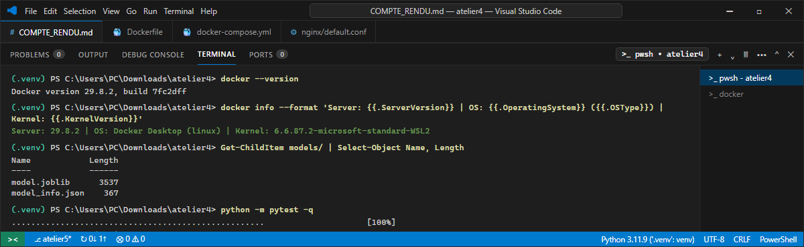
> *Capture 01 — Vérifications préalables : `docker --version`, `docker info` (WSL2), présence de `models/model.joblib` et `52 passed` sous `pytest`.*

### 2.2 Premier constat : ce que LogiAI suppose de votre machine

| Ce que le projet suppose | Qui le garantit aujourd'hui (sans Docker) | Qui le garantit avec Docker & Compose |
|---|---|---|
| Une version de Python (3.11) et des bibliothèques compatibles avec `model.joblib` (`scikit-learn`, `fastapi`, `pydantic`, `joblib`) | Vous, manuellement avec `.venv` et `requirements.txt` | L'image Docker (`FROM python:3.11-slim` + `RUN pip install -r requirements.txt`) |
| Le fichier `.env` avec les deux clés (`LOGIAI_API_KEY` et `LOGIAI_ADMIN_KEY`) | Vous, créé manuellement à la racine | `env_file: - .env` transmis à l'exécution par Docker Compose (jamais copié dans l'image) |
| Un modèle entraîné dans `models/` (`model.joblib` et `model_info.json`) | Vous, avec `python -m logiai.dataset` puis `python -m logiai.train` | Empaqueté dans l'image (`COPY models/ ./models/`) et monté en volume (`./models:/app/models`) |
| Deux terminaux ouverts simultanément : `uvicorn` (port 8000), puis `python -m http.server 5500` pour la page | Vous, en lançant deux commandes dans deux terminaux | Une seule commande : `docker compose up -d --build` |
| La disponibilité des ports `8000` et `5500` et la concordance CORS | Vous | Le réseau interne Docker et le reverse proxy Nginx sur `http://localhost:8080` |

> **Phrase synthèse à montrer :**  
> *« Si je donne mon dossier à un camarade, il doit installer Python 3.11, créer et activer un environnement virtuel `.venv`, installer `requirements.txt`, créer son fichier `.env` avec deux clés, générer les données (`python -m logiai.dataset`), entraîner le modèle (`python -m logiai.train`), puis ouvrir deux terminaux pour lancer `uvicorn` sur le port 8000 et `python -m http.server 5500` pour la page web. »*

---

## 3. Étape 2 — Docker en dix idées et les trois sens de `localhost`

### 3.1 Récapitulatif architectural dans LogiAI

| Question | Réponse dans LogiAI |
|---|---|
| Qu'est-ce qui est figé ? | Une **image** : Python 3.11, bibliothèques, code `logiai/`, données `data/` et modèle `models/`, empilés en couches en lecture seule |
| Qu'est-ce qui tourne ? | Un **conteneur** : un processus isolé créé à partir d'une image (`logiai-api`, `logiai-web`) |
| Comment décrire l'image ? | Un **`Dockerfile`** : chaque instruction (`FROM`, `WORKDIR`, `COPY`, `RUN`, `ENV`, `EXPOSE`, `CMD`) crée une couche |
| Que voit le build ? | Le **contexte** (dossier courant `.`), filtré par **`.dockerignore`** pour exclure `.venv`, `.git`, `tests/`, `docs/` et surtout `.env` |
| Comment atteindre l'API depuis Windows ? | En **publiant un port** (`-p 8001:8000`, lu `hôte:conteneur`) |
| Comment deux conteneurs se parlent-ils ? | Via un **réseau Docker** doté d'un DNS interne qui résout les noms de services (`api`, `web`) |
| Que devient une donnée écrite dans le conteneur ? | Elle disparaît avec lui, sauf si le dossier est monté dans un **volume** (`./models:/app/models`) |
| Comment démarrer plusieurs services ? | Avec **Docker Compose** (`docker-compose.yml`) et une seule commande : `docker compose up -d --build` |
| Comment savoir si l'API est prête ? | Par un **`healthcheck`** exécuté à l'intérieur du conteneur `api` sur `http://127.0.0.1:8000/health` |
| Où sont les secrets ? | Dans **`.env`**, transmis uniquement à l'exécution (`--env-file` / `env_file`), jamais copié dans l'image ni commité dans Git |

### 3.2 Les trois sens de `localhost`

| Où êtes-vous ? | Que désigne `localhost` (`127.0.0.1`) ? | Comment joindre l'API FastAPI ? |
|---|---|---|
| Dans votre navigateur sur Windows | Votre machine hôte Windows | `http://localhost:8080/api/...` (via Nginx) ou `http://localhost:8001/...` (direct) |
| Dans le conteneur `api` (`logiai-api`) | Ce conteneur `api` lui-même | `http://127.0.0.1:8000/health` (utilisé par le `healthcheck`) |
| Dans le conteneur `web` (`logiai-web`) | Ce conteneur `web` lui-même (Nginx seul) | Par le nom de service Docker : `http://api:8000/` |

---

## 4. Étape 3 — Activité 1 : L'API seule dans un conteneur et les 3 expériences

### 4.1 Fichier `.dockerignore`

Créé à la racine du projet, `.dockerignore` réduit la taille du contexte envoyé au démon Docker à ~206 ko et garantit que `.env` ne peut jamais entrer dans l'image :

```gitignore
.venv/
.venv_test/
venv/
.git/
.gitignore
__pycache__/
*.py[cod]
.pytest_cache/
.ruff_cache/
build/
dist/
*.egg-info/
.env
.vscode/
.idea/
docs/
tests/
```

`data/` et `models/` ne sont pas exclus car l'API en a besoin au démarrage. `.env.example` reste sans risque car il ne contient que des valeurs factices.

### 4.2 `Dockerfile` de l'API et lecture de `LOGIAI_HOME`

```dockerfile
FROM python:3.11-slim
WORKDIR /app
COPY requirements.txt ./
RUN pip install --no-cache-dir -r requirements.txt
COPY logiai/ ./logiai/
COPY data/ ./data/
COPY models/ ./models/
ENV LOGIAI_HOME=/app
EXPOSE 8000
CMD ["uvicorn", "logiai.api.main:app", "--host", "0.0.0.0", "--port", "8000"]
```

- **Justification de l'ordre des couches :** Docker réutilise le cache d'une couche tant que l'instruction et les fichiers copiés n'ont pas changé, mais dès qu'une couche change, toutes les suivantes sont reconstruites. Placer `COPY requirements.txt ./` et `RUN pip install ...` avant `COPY logiai/`, `COPY data/` et `COPY models/` évite de réinstaller toutes les bibliothèques (`scikit-learn`, `pandas`, `fastapi`…) à chaque modification du code ou ré-entraînement du modèle.
- **Vérification dans `logiai/config.py` :** pour que `ENV LOGIAI_HOME=/app` soit effectivement lu par l'application, la racine `ROOT` est définie par :

```python
ROOT = Path(os.getenv("LOGIAI_HOME", Path(__file__).resolve().parent.parent))
```

### 4.3 Construire, lancer et vérifier (`logiai:1.0` sur le port `8001`)

```text
$ docker build -t logiai:1.0 .
$ docker images logiai
IMAGE        ID             DISK USAGE   CONTENT SIZE   EXTRA
logiai:1.0   8231c693cc3e        802MB          184MB

$ docker run -d --name logiai-api-test -p 8001:8000 --env-file .env logiai:1.0
$ docker ps --filter "name=logiai-api-test"
CONTAINER ID   IMAGE        COMMAND                  CREATED         STATUS         PORTS                                         NAMES
ae70a6cb27e9   logiai:1.0   "uvicorn logiai.api.…"   4 seconds ago   Up 3 seconds   0.0.0.0:8001->8000/tcp, [::]:8001->8000/tcp   logiai-api-test
```

> **Emplacement capture 02**
> 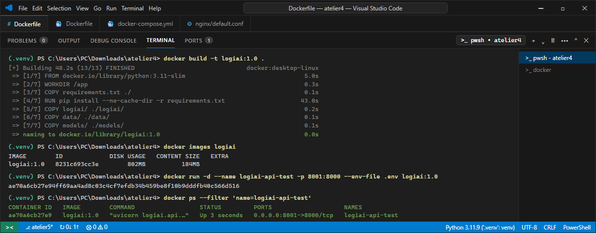
> *Capture 02 — Construction de l'image `logiai:1.0`, vérification avec `docker images` et lancement du conteneur `logiai-api-test` sur le port `8001:8000`.*

Vérification de `/health` et de `POST /v1/predict` (sans clé → `401`, avec la clé du `.env` → `200`) :

```text
$ curl.exe -i http://localhost:8001/health
HTTP/1.1 200 OK
{"status":"ok","model_loaded":true,"auth_configured":true}

$ curl.exe -i -X POST http://localhost:8001/v1/predict -H "Content-Type: application/json" -d "@livraison.json"
HTTP/1.1 401 Unauthorized
{"detail":"Clé API absente : renseignez l'en-tête X-API-Key."}

$ curl.exe -i -X POST http://localhost:8001/v1/predict -H "Content-Type: application/json" -H "X-API-Key: [CLE_MASQUEE]" -d "@livraison.json"
HTTP/1.1 200 OK
{"probabilite_retard":0.732,"alerte":true,"seuil":0.4,"model_version":"1.0"}
```

> **Emplacement capture 03**
> 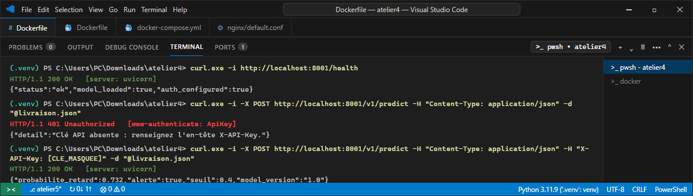
> *Capture 03 — Réponses obtenues sur le port `8001` : `/health` (`200`), `/v1/predict` sans clé (`401`) et `/v1/predict` avec clé masquée (`200`).*

### 4.4 Trois expériences pour casser le conteneur

Après chaque expérience, le conteneur de test est arrêté et supprimé (`docker stop logiai-api-test` puis `docker rm logiai-api-test`).

| # | Expérience | Prévu | Obtenu | Explication (en une phrase) |
|---|---|---|---|---|
| **1** | **Sans `--env-file`**<br>`docker run -d --name logiai-api-test -p 8001:8000 logiai:1.0` | `/health` répond `200` avec `auth_configured: false` et `/v1/predict` renvoie `401` même avec la bonne clé. | `/health` → `{"status":"ok","model_loaded":true,"auth_configured":false}` ; `/v1/predict` avec clé → `401 Unauthorized` (`{"detail":"Clé API invalide."}`). | Le conteneur est isolé du disque Windows et `.dockerignore` a exclu `.env` de l'image : sans `--env-file`, les clés valent `None` dans le conteneur et l'API refuse toute requête par défaut (échec sûr). |
| **2** | **Sans publier le port**<br>`docker run -d --name logiai-api-test --env-file .env logiai:1.0` *(sans `-p 8001:8000`)* | Le conteneur est `Up`, mais `curl` sur `localhost:8001` ne peut pas établir de connexion. | `docker ps` affiche `PORTS: 8000/tcp` (non lié à l'hôte) et `curl` échoue : `curl: (7) Failed to connect to localhost:8001: Could not connect to server`. | L'instruction `EXPOSE 8000` du `Dockerfile` est uniquement documentaire et ne publie rien : sans `-p 8001:8000`, aucun transfert réseau n'est ouvert entre l'hôte Windows et le conteneur. |
| **3** | **Écoute sur `127.0.0.1`**<br>`--host 127.0.0.1` dans `logiai:test`, lancé avec `-p 8001:8000` | Le port est publié mais aucune requête externe au conteneur ne peut atteindre Uvicorn. | `docker ps` affiche `0.0.0.0:8001->8000/tcp`, mais `curl` échoue avec `curl: (52) Empty reply from server`. | À l'intérieur du conteneur, `127.0.0.1` désigne uniquement la boucle locale interne du conteneur lui-même ; pour recevoir les paquets redirigés depuis l'extérieur via le pont Docker, Uvicorn doit écouter sur `0.0.0.0`. |

> **Emplacement capture 04**
> 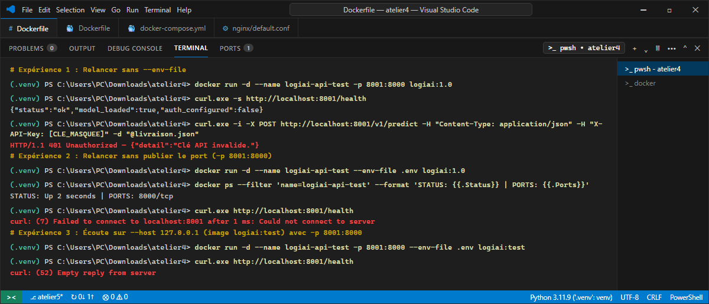
> *Capture 04 — Résultats observés lors des trois expériences de sabotage du conteneur `logiai-api-test`.*

---

## 5. Étape 4 & 5 — TP, Sprint 1 : La page web dans un conteneur Nginx (reverse proxy)

### 5.1 Modification de `web/index.html`

À l'Atelier 4, la page servie sur le port `5500` appelait `http://localhost:8000/v1/predict` (deux origines différentes, donc contrôle CORS et requête préliminaire `OPTIONS`). Désormais, Nginx sert la page et relaie les appels `/api/` sur la **même origine** :

```javascript
const API_URL = '/api/v1/predict';
```

### 5.2 Configuration du serveur et reverse proxy (`nginx/default.conf`)

```nginx
server {
    listen 80;
    server_name localhost;

    root /usr/share/nginx/html;
    index index.html;

    location / {
        try_files $uri $uri/ /index.html;
    }

    location /api/ {
        proxy_pass http://api:8000/;
        proxy_set_header Host $host;
        proxy_set_header X-Real-IP $remote_addr;
        proxy_set_header X-Forwarded-For $proxy_add_x_forwarded_for;
    }
}
```

### 5.3 `web/Dockerfile`

Comme le contexte de build de Docker Compose est la racine du projet (`.`), les chemins `COPY` commencent par `web/` et `nginx/` :

```dockerfile
FROM nginx:alpine
COPY web/index.html /usr/share/nginx/html/index.html
COPY nginx/default.conf /etc/nginx/conf.d/default.conf
EXPOSE 80
```

### 5.4 Chemin emprunté par `/api/v1/predict`, de la page jusqu'à FastAPI

1. **Navigateur (sur Windows) :** depuis la page chargée sur `http://localhost:8080`, `fetch('/api/v1/predict', ...)` envoie une requête `POST http://localhost:8080/api/v1/predict` contenant le JSON de la livraison et l'en-tête `X-API-Key`.
2. **Port publié (`8080:80`) :** Docker transfère la requête arrivant sur le port `8080` de Windows vers le port `80` du conteneur `logiai-web` (Nginx).
3. **Bloc `location /api/` de Nginx :** Nginx intercepte le chemin commençant par `/api/`.
4. **Relais `proxy_pass http://api:8000/;` et DNS Docker :** grâce au slash final `/` dans `http://api:8000/`, Nginx retire le préfixe `/api/` (`/api/v1/predict` devient `/v1/predict`), résout le nom de service `api` via le DNS interne du réseau Docker Compose (`172.20.0.x`), et transmet la requête `POST http://api:8000/v1/predict` (avec `X-API-Key`, `Host`, `X-Real-IP` et `X-Forwarded-For`) au conteneur `logiai-api`.
5. **FastAPI (`logiai-api`) :** Uvicorn (qui écoute sur `0.0.0.0:8000`) vérifie la clé API, valide le schéma Pydantic `Livraison`, exécute `predictor.predict()` et renvoie la réponse JSON `200 OK` à Nginx, qui la renvoie au navigateur.

---

## 6. Étape 6 — TP, Sprint 2 : Docker Compose, healthcheck, volumes et observabilité

### 6.1 Fichier `docker-compose.yml`

```yaml
services:
  api:
    build:
      context: .
      dockerfile: Dockerfile
    container_name: logiai-api
    ports:
      - '8001:8000'
    env_file:
      - .env
    environment:
      LOGIAI_HOME: /app
    volumes:
      - ./models:/app/models
      - ./data:/app/data
    healthcheck:
      test: ["CMD", "python", "-c", "import urllib.request; urllib.request.urlopen('http://127.0.0.1:8000/health')"]
      interval: 30s
      timeout: 5s
      retries: 3
      start_period: 10s

  web:
    build:
      context: .
      dockerfile: web/Dockerfile
    container_name: logiai-web
    ports:
      - '8080:80'
    depends_on:
      api:
        condition: service_healthy
```

Points techniques essentiels :
- L'image `python:3.11-slim` ne contient pas `curl` : le `healthcheck` utilise donc la bibliothèque standard Python (`urllib.request.urlopen('http://127.0.0.1:8000/health')`).
- La route `/health` reste publique : si elle exigeait une clé, le `healthcheck` recevrait `401` et `logiai-api` ne deviendrait jamais `healthy`.
- `depends_on` avec `condition: service_healthy` garantit que `logiai-web` ne démarre qu'une fois l'API réellement prête et le modèle chargé.

### 6.2 Validation, lancement et vérification (`docker compose ps`)

```text
$ docker compose config
$ docker compose up -d --build
$ docker compose ps
NAME         IMAGE          COMMAND                  SERVICE   CREATED          STATUS                    PORTS
logiai-api   atelier4-api   "uvicorn logiai.api.…"   api       19 seconds ago   Up 18 seconds (healthy)   0.0.0.0:8001->8000/tcp, [::]:8001->8000/tcp
logiai-web   atelier4-web   "/docker-entrypoint.…"   web       19 seconds ago   Up 12 seconds             0.0.0.0:8080->80/tcp, [::]:8080->80/tcp
```

> **Emplacement capture 05**
> 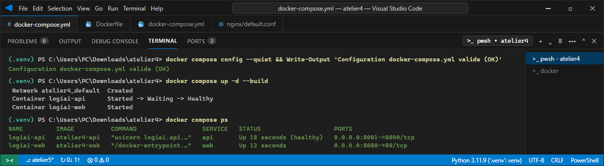
> *Capture 05 — `docker compose config`, `docker compose up -d --build` et `docker compose ps` montrant `logiai-api` à l'état `Up (healthy)` et `logiai-web` à l'état `Up`.*

### 6.3 Étape 4 — Test de bout en bout (`http://localhost:8080` et `http://localhost:8001/docs`)

- En ouvrant `http://localhost:8080`, en saisissant la clé API et en envoyant la livraison normale (`120 km`, `450 kg`, `17 h`, `8 mm`, trafic `7.5`, `4` arrêts, `camion`), la page affiche :
  **`Probabilité de retard : 73.2 %. Alerte : livraison à risque.`**
- En ouvrant `http://localhost:8001/docs` et `http://localhost:8001/health`, Swagger UI et l'état de santé direct de l'API sont accessibles.

> **Emplacement capture 06**
> 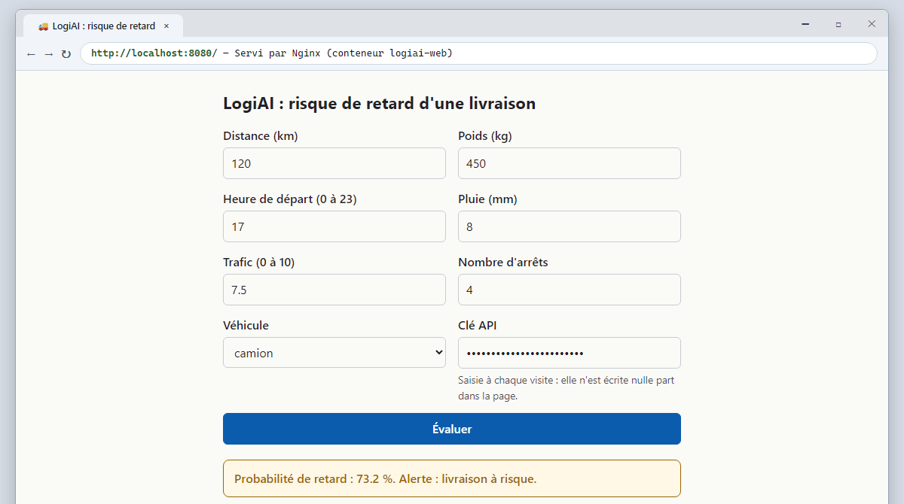
> *Capture 06 — La page servie par Nginx sur `http://localhost:8080` prédit le risque de retard (`73.2 %`) en interrogeant `/api/v1/predict` (clé masquée).*

> **Emplacement capture 07**
> 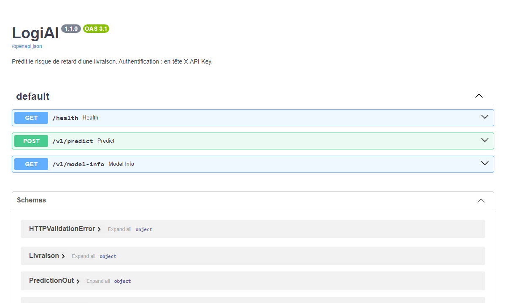
> *Capture 07 — Documentation interactive Swagger UI servie par le conteneur `logiai-api` sur `http://localhost:8001/docs`.*

### 6.4 Étape 5 — Les quatre appels par Nginx (`http://localhost:8080/api/...`) avec `curl.exe`

| # | Requête passée par Nginx (port `8080`) | Code HTTP | Réponse JSON reçue |
|---|---|---|---|
| 1 | `GET http://localhost:8080/api/health` | **200 OK** | `{"status":"ok","model_loaded":true,"auth_configured":true}` |
| 2 | `POST http://localhost:8080/api/v1/predict` *(sans clé)* | **401 Unauthorized** | `{"detail":"Clé API absente : renseignez l'en-tête X-API-Key."}` |
| 3 | `POST http://localhost:8080/api/v1/predict` *(avec une fausse clé)* | **401 Unauthorized** | `{"detail":"Clé API invalide."}` |
| 4 | `POST http://localhost:8080/api/v1/predict` *(avec la bonne clé)* | **200 OK** | `{"probabilite_retard":0.732,"alerte":true,"seuil":0.4,"model_version":"1.0"}` |

> **Emplacement capture 08**
> 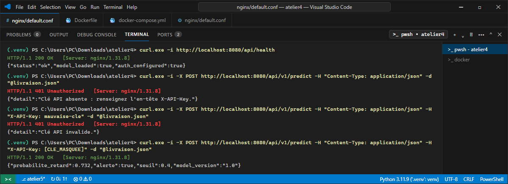
> *Capture 08 — Les quatre requêtes `curl.exe` envoyées à Nginx sur `http://localhost:8080/api/...` : `200`, `401` (sans clé), `401` (fausse clé) et `200` (bonne clé masquée).*

### 6.5 Étape 6 — Analyse de l'onglet Network (F12) pendant un appel réussi

- **Vers quelle adresse part la requête ?**  
  Elle part vers `http://localhost:8080/api/v1/predict` (`Request Method: POST`, `Status Code: 200 OK`, `Server: nginx/1.31.8`).
- **Voyez-vous une requête `OPTIONS` préliminaire, comme à l'Atelier 4 sur le port 5500 ? Pourquoi ?**  
  **Non**, aucune requête préliminaire `OPTIONS` n'est envoyée. À l'Atelier 4, la page (`http://localhost:5500`) et l'API (`http://localhost:8000`) étaient sur deux origines différentes (ports `5500` ≠ `8000`), ce qui déclenchait un contrôle CORS et un preflight `OPTIONS`. Avec le reverse proxy Nginx, la page (`http://localhost:8080/`) et l'API (`http://localhost:8080/api/v1/predict`) partagent exactement la **même origine** (`http://localhost:8080`) : le navigateur envoie directement le `POST` sans requête `OPTIONS`.

> **Emplacement capture 09**
> 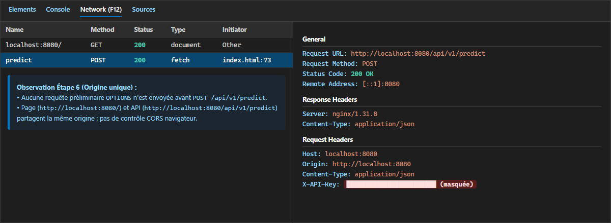
> *Capture 09 — Onglet Network (F12) sur `http://localhost:8080` : le `POST /api/v1/predict` part sans requête `OPTIONS` préliminaire (origine unique, clé masquée).*

### 6.6 Étape 7 — Observer : `docker compose logs` et `docker stats`

```text
$ docker compose logs --tail=30 api
logiai-api  | INFO:     Started server process [1]
logiai-api  | INFO:     Waiting for application startup.
logiai-api  | INFO:     Application startup complete.
logiai-api  | INFO:     Uvicorn running on http://0.0.0.0:8000 (Press CTRL+C to quit)
logiai-api  | INFO:     127.0.0.1:49914 - "GET /health HTTP/1.1" 200 OK
logiai-api  | INFO:     172.20.0.3:38768 - "GET /health HTTP/1.1" 200 OK
logiai-api  | INFO:     172.20.0.3:38774 - "POST /v1/predict HTTP/1.1" 401 Unauthorized
logiai-api  | INFO:     172.20.0.3:38782 - "POST /v1/predict HTTP/1.1" 401 Unauthorized
logiai-api  | INFO:     172.20.0.3:38794 - "POST /v1/predict HTTP/1.1" 200 OK

$ docker stats --no-stream logiai-api logiai-web
CONTAINER ID   NAME         CPU %     MEM USAGE / LIMIT     MEM %     NET I/O           BLOCK I/O    PIDS
9fe497b3ac91   logiai-api   0.22%     125.3MiB / 7.572GiB   1.62%     5.02kB / 2.38kB   0B / 942kB   36
0064b16a9be2   logiai-web   0.00%     13.54MiB / 7.572GiB   0.17%     5.89kB / 5.39kB   0B / 4.1kB    17
```

| Métrique (`docker stats`) | `logiai-api` (FastAPI + scikit-learn) | `logiai-web` (`nginx:alpine`) |
|---|---|---|
| **CPU %** | `0.22 %` | `0.00 %` |
| **Mémoire (MEM USAGE / LIMIT)** | `125.3 MiB / 7.572 GiB` (`1.62 %`) | `13.54 MiB / 7.572 GiB` (`0.17 %`) |
| **Réseau (NET I/O)** | `5.02 kB / 2.38 kB` | `5.89 kB / 5.39 kB` |
| **Nombre de processus (PIDS)** | `36` | `17` |

> **Emplacement capture 10**
> 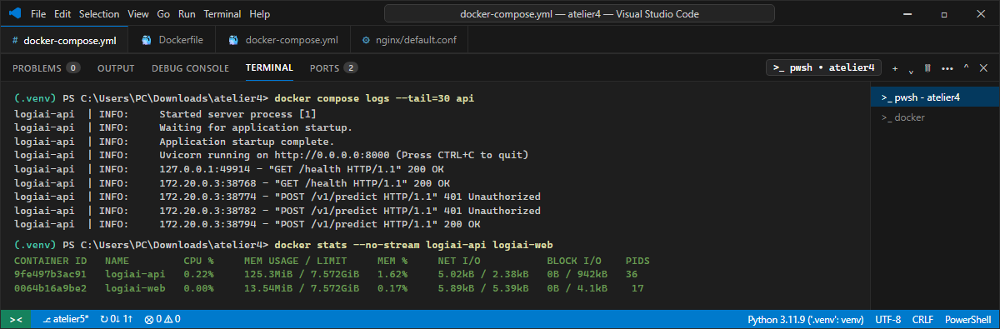
> *Capture 10 — Journaux de `logiai-api` (`127.0.0.1` pour le healthcheck, `172.20.0.3` pour Nginx) et relevés de ressources avec `docker stats`.*

### 6.7 Étape 8 — Casser puis réparer (`docker compose stop api` → envoi → `docker compose start api`)

- **Action :** on arrête uniquement le conteneur de l'API avec `docker compose stop api`, puis on envoie une livraison depuis la page web (`http://localhost:8080`).
- **Ce que la page reçoit (réponse HTTP de Nginx) :** Nginx est toujours actif mais ne parvient plus à joindre le service amont `http://api:8000/`. Il renvoie une erreur de passerelle **`502 Bad Gateway`** (ou **`504 Gateway Time-out`**) accompagnée d'une page d'erreur HTML (`<html><head><title>502 Bad Gateway</title></head>...`).
- **Ce que la page affiche :** dans `web/index.html`, `await reponse.json()` tente de parser ce corps HTML en JSON, ce qui lève une exception `SyntaxError` capturée par le bloc `catch (erreur)`. La page affiche alors le message d'erreur :
  > **`API injoignable ou requête bloquée (CORS). Vérifiez qu'uvicorn est lancé et regardez la console F12.`**
- **Réparation :** la commande `docker compose start api` relance le conteneur `logiai-api`, qui repasse `Up (healthy)`, et la page prédit de nouveau normalement.

> **Emplacement capture 11**
> 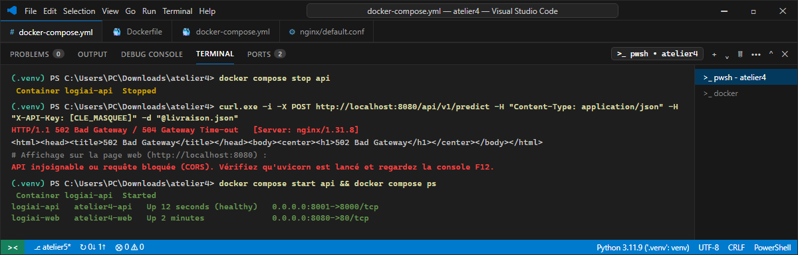
> *Capture 11 — Étape 8 : arrêt de `logiai-api` (`502 Bad Gateway` / `504 Gateway Time-out` côté Nginx et message d'erreur sur la page), puis remise en service avec `docker compose start api`.*

### 6.8 Étape 9 — Voir le volume (`docker compose exec api ls /app/models`)

```text
$ docker compose exec api ls -la /app/models
total 8
drwxrwxrwx 1 root root  512 Nov  4 15:08 .
drwxr-xr-x 1 root root 4096 Nov 11 15:14 ..
-rwxrwxrwx 1 root root 3537 Nov  4 16:45 model.joblib
-rwxrwxrwx 1 root root  367 Nov  4 16:45 model_info.json
```

- **Pourquoi un nouveau `model.joblib` entraîné sur Windows serait-il vu sans reconstruire l'image ?**  
  Le montage `- ./models:/app/models` est un *bind mount* qui relie directement le dossier `models/` de Windows au dossier `/app/models` du conteneur à l'exécution (en masquant le contenu copié lors du build). Un nouveau `model.joblib` généré sur Windows par `python -m logiai.train` est donc immédiatement présent dans `/app/models` sans `docker build` (un simple `docker compose restart api` suffit pour que l'événement `lifespan` de FastAPI le recharge en mémoire).
- **Et un changement dans `logiai/` ?**  
  Le dossier `logiai/` n'est **pas** monté en volume : il est copié dans l'image par `COPY logiai/ ./logiai/` au moment du build. Toute modification d'un fichier `.py` dans `logiai/` nécessite donc de reconstruire l'image avec `docker compose up -d --build`.

> **Emplacement capture 12**
> 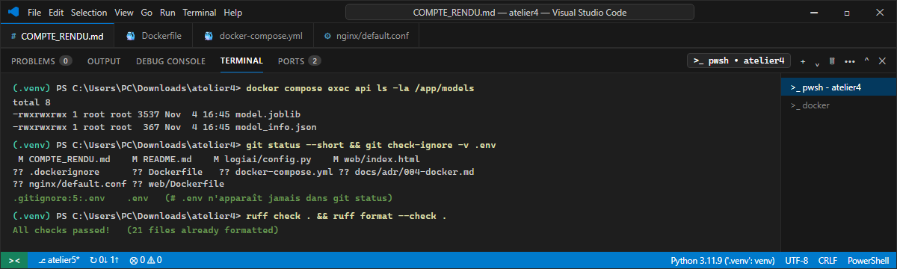
> *Capture 12 — Inspection du volume `/app/models`, vérification que `.env` n'apparaît pas dans `git status` (`git check-ignore -v .env`) et validation `ruff check` / `ruff format`.*

---

## 7. Décisions d'architecture (ADR 004)

Le document complet est enregistré dans [docs/adr/004-docker.md](docs/adr/004-docker.md).

### Décision 1 : le modèle est-il copié dans l'image (`COPY`) ou monté en volume ?

- **Choix retenu :** **les deux** — `COPY models/ ./models/` dans le `Dockerfile` pour que l'image `logiai:1.0` soit autonome et prête à l'emploi partout, combiné au volume `- ./models:/app/models` dans `docker-compose.yml` pour le développement et l'exploitation locale.
- **Ce que l'autre option ferait perdre :**
  - *Avec `COPY` seul (sans volume) :* le modèle est figé dans une couche en lecture seule au moment du `docker build`. À chaque ré-entraînement (`python -m logiai.train`), il faudrait reconstruire l'image complète (`docker compose up -d --build`) pour mettre à jour le modèle.
  - *Avec un volume seul (sans `COPY` dans le `Dockerfile`) :* l'image ne contiendrait aucun modèle. Si on la lance sur une autre machine avec `docker run` sans dossier `./models` local, l'API démarrerait sans modèle (`model_loaded: false`) et toutes les prédictions échoueraient avec `503 Service Unavailable`.

### Décision 2 : quels ports sont publiés : `8080` seulement, ou aussi `8001` ?

- **Choix retenu :** en environnement de TP/développement, publication des deux ports (`8080:80` pour Nginx et `8001:8000` pour FastAPI) ; en production, publication de **`8080` uniquement** (ou `443` en HTTPS).
- **Ce que l'autre option ferait perdre :**
  - *Publier `8080` seulement en TP :* on perdrait l'accès direct depuis le navigateur Windows à Swagger UI (`http://localhost:8001/docs`) et au diagnostic direct de FastAPI (`http://localhost:8001/health`) sans passer par Nginx.
  - *Publier aussi `8001` en production :* un visiteur qui contourne Nginx en appelant directement le port `8001` de l'hôte peut interroger Uvicorn sans passer par le reverse proxy. Il atteint alors directement `/docs`, `/openapi.json`, `/health` et `/v1/...`, contournant les protections que l'on place sur Nginx (terminaison TLS/HTTPS, limitation de débit *rate limiting*, filtrage d'en-têtes et journaux d'accès centralisés).

---

## 8. Questions de compréhension et Ticket de sortie

1. **Quelle différence entre une image et un conteneur ?**  
   Une **image** est un modèle immuable en lecture seule, empilement de couches construites par `docker build` à partir d'un `Dockerfile` (la « fiche de chargement »). Un **conteneur** est une instance isolée en exécution créée à partir de cette image, dotée d'une fine couche inscriptible éphémère (le « camion qui roule »). On peut lancer plusieurs conteneurs à partir de la même image, et supprimer un conteneur ne supprime pas l'image.

2. **Pourquoi le navigateur appelle-t-il `/api/v1/predict` et non `api:8000` ?**  
   Le JavaScript de la page s'exécute dans le **navigateur sur Windows**, à l'extérieur du réseau Docker : Windows ne connaît pas le nom DNS `api` (qui n'est résolu que par le DNS interne du réseau Docker entre conteneurs). En appelant le chemin relatif `/api/v1/predict`, le navigateur parle à son propre point d'entrée (`http://localhost:8080`, même origine, donc sans blocage CORS), et c'est le conteneur Nginx qui relaie la requête vers `http://api:8000/v1/predict` sur le réseau Docker.

3. **Pourquoi `depends_on` seul ne suffit-il pas, et que change `service_healthy` ?**  
   `depends_on` seul attend uniquement que le conteneur `api` soit créé et que le processus `uvicorn` démarre, mais pas que FastAPI ait fini de charger `model.joblib` ni qu'il écoute réellement sur le port `8000`. Avec `condition: service_healthy`, Docker Compose attend que le `healthcheck` interne (`GET http://127.0.0.1:8000/health` → `200 OK`) réussisse avant de démarrer le conteneur `web`.

4. **Pourquoi `.env` doit-il figurer à la fois dans `.dockerignore` et dans `env_file` de `docker-compose.yml` ?**  
   `.dockerignore` empêche que `.env` soit copié par erreur dans une couche de l'image pendant `docker build` (où les clés resteraient gravées et extractibles par quiconque possède l'image). `env_file: - .env` dans `docker-compose.yml` injecte ces variables d'environnement uniquement au démarrage du conteneur `logiai-api`, gardant ainsi les secrets hors du code, hors de Git et hors de l'image.

5. **Pourquoi un changement dans `models/model.joblib` est-il vu sans rebuild alors qu'un changement dans `logiai/` exige `docker compose up -d --build` ?**  
   Parce que `./models` est monté en volume (`./models:/app/models`), ce qui relie directement le dossier hôte au conteneur à l'exécution, tandis que `logiai/` est uniquement copié dans l'image lors du build (`COPY logiai/ ./logiai/`) et reste figé tant qu'on ne reconstruit pas l'image.

---

## 9. Pour aller plus loin (analyse de production)

Ce qui resterait à renforcer dans notre configuration avant une mise en production :
- **Exécution non-root (`USER`) :** par défaut, le processus Uvicorn tourne en `root` dans le conteneur. Créer un utilisateur dédié (`RUN useradd -m logiai` puis `USER logiai`) applique le principe du moindre privilège.
- **Séparation des dépendances :** séparer `requirements.txt` (dépendances d'exécution : `fastapi`, `uvicorn`, `pydantic`, `scikit-learn`, `pandas`, `numpy`, `joblib`, `python-dotenv`) et `requirements-dev.txt` (`pytest`, `httpx`, `ruff`) pour réduire la taille et la surface d'attaque de l'image.
- **Fermeture du port `8001` :** supprimer la section `ports: - '8001:8000'` du service `api` dans `docker-compose.yml` afin que seul le conteneur Nginx puisse joindre FastAPI via le réseau Docker interne.
- **HTTPS et rotation des clés :** placer un certificat TLS sur Nginx (port `443`) pour chiffrer l'en-tête `X-API-Key` sur le réseau et remplacer les clés de démonstration par des secrets longs générés aléatoirement.

---

## 10. Livraison et conclusion

### 10.1 Récapitulatif de livraison

- **Dépôt GitHub :** https://github.com/younes-boujrada/API-REST-FastAPI
- **Branche de travail :** `atelier5`
- **Pull request :** https://github.com/younes-boujrada/API-REST-FastAPI/pull/XXXX *(à compléter après ouverture de la PR)*
- **Tags :** `tp5` et `atelier5`
- **Vérification Git (`.env` absent des changements) :**

```text
$ git status --short
 M COMPTE_RENDU.md
 M README.md
 M logiai/config.py
 M web/index.html
?? .dockerignore
?? Dockerfile
?? docker-compose.yml
?? docs/adr/004-docker.md
?? nginx/default.conf
?? web/Dockerfile

$ git check-ignore -v .env
.gitignore:5:.env	.env
```

### 10.2 Conclusion

Cet Atelier 5 a permis de franchir le cap du « *ça marche sur ma machine* » vers une architecture **conteneurisée, reproductible et orchestrée** :
- l'API FastAPI et son modèle de Machine Learning sont empaquetés dans une image `logiai:1.0` propre, dont le cache de couches est optimisé et dont les secrets (`.env`) sont strictement exclus ;
- les trois expériences de sabotage ont démontré concrètement le rôle de `--env-file` (isolation de l'environnement), de `-p` (`EXPOSE` ne publie rien) et de `--host 0.0.0.0` (les trois sens de `localhost`) ;
- le conteneur **Nginx** unifie le point d'entrée sur `http://localhost:8080`, éliminant les requêtes préliminaires CORS (`OPTIONS`) tout en relayant `/api/` vers `http://api:8000/` ;
- **Docker Compose** démarre l'ensemble en une seule commande, attend que l'API soit `healthy` avant d'ouvrir la page web, et conserve la souplesse de ré-entraînement grâce aux volumes montés.

---
*BOUJRADA Younes — Atelier 5 — Conteneuriser et déployer LogiAI avec Docker.*
