# Compte rendu — Atelier 4 : tester, sécuriser et appeler l'API LogiAI

**Nom et prénom :** BOUJRADA Younes
**Groupe :** ............................
**Module :** Développement et déploiement d'applications intelligentes
**Année universitaire :** 2026 - 2027
**Livrable :** API FastAPI testée, sécurisée par clé API, appelée depuis une page web

---

## Table des matières

1. [Contexte et objectifs](#1-contexte-et-objectifs)
2. [Environnement et démarche](#2-environnement-et-démarche)
3. [Activité 1 — Casser son API](#3-activité-1--casser-son-api)
4. [Activité 2 — Les 2 bugs de bornes](#4-activité-2--les-2-bugs-de-bornes)
5. [Sprint 1 — La clé API](#5-sprint-1--la-clé-api)
6. [Sprint 2 — Le client web](#6-sprint-2--le-client-web)
7. [Démonstration via Swagger UI](#7-démonstration-via-swagger-ui)
8. [Résultats finaux](#8-résultats-finaux)
9. [Questions de compréhension](#9-questions-de-compréhension)
10. [Décisions d'architecture (ADR 003)](#10-décisions-darchitecture-adr-003)
11. [Livraison](#11-livraison)
12. [Conclusion](#12-conclusion)

---

## 1. Contexte et objectifs

Le projet **LogiAI** prédit le risque de retard d'une livraison à partir de 7 variables
(distance, poids, heure de départ, pluie, trafic, nombre d'arrêts, type de véhicule) et expose
la prédiction par une API REST construite avec **FastAPI**. Le TP précédent (Atelier 3) avait
créé le schéma Pydantic `Livraison`, la route `POST /v1/predict` et une première suite de tests.
Une interface **Streamlit** (`streamlit_app.py`) consommait déjà le modèle en local.

L'**Atelier 4** poursuit ce travail en quatre parties :

| Partie | Objectif |
|---|---|
| Activité 1 — Casser son API | Envoyer volontairement de mauvaises requêtes pour vérifier que le schéma les refuse |
| Activité 2 — Les 2 bugs | Tester **les deux côtés** de chaque borne pour découvrir deux bugs volontaires et les corriger |
| Sprint 1 — La clé API | Protéger l'API : authentification (401), autorisation (403), secrets hors de Git |
| Sprint 2 — Le client web | Appeler l'API depuis une page HTML avec `fetch`, gérer les erreurs et comprendre CORS |

Résultat attendu : une API **incapable d'accepter des données invalides**, protégée des
utilisateurs non identifiés, et consommable par le navigateur uniquement depuis l'origine autorisée.

> **Emplacement capture 01**
> 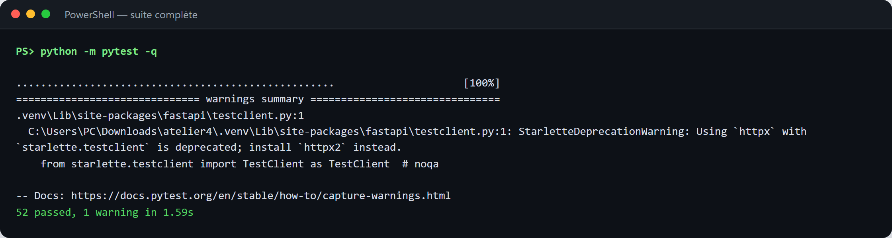
> *Capture 01 — Vue d'ensemble : `python -m pytest -q` après les deux sprints.*

---

## 2. Environnement et démarche

- **Python 3.11** dans un environnement virtuel `.venv` (`python -m venv .venv`).
- **Dépendances** (`requirements.txt`) : FastAPI, uvicorn, pydantic, python-dotenv, pytest, ruff, httpx, scikit-learn, joblib.
- **Jeux de clés de test** définis dans `tests/conftest.py` via `monkeypatch` :
  `cle-test-utilisateur` (rôle `user`) et `cle-test-admin` (rôle `admin`) — les tests n'utilisent **jamais** les vraies clés du fichier `.env`.
- **Démarche itérative en « sprints »** :
  1. Envoyer des requêtes brutes pour casser l'API (activité 1) ;
  2. Automatiser chaque cas refusé dans `tests/test_casser.py` avec `@pytest.mark.parametrize` ;
  3. Écrire `tests/test_limites.py` (les 2 côtés de chaque borne) → découverte des 2 bugs (activité 2) ;
  4. Corriger `logiai/api/schemas.py`, puis sécuriser l'API (sprint 1) ;
  5. Construire le client web `web/index.html` (sprint 2) ;
  6. Vérifier : `python -m pytest`, `ruff check .`, `ruff format --check .`.

```text
$ .venv\Scripts\Activate.ps1
$ python -m logiai.dataset && python -m logiai.train
$ python -m uvicorn logiai.api.main:app --reload
$ python -m http.server 5500 --directory web      # 2e terminal, client web
```

---

## 3. Activité 1 — Casser son API

Toutes les requêtes ont été envoyées vers `POST /v1/predict` avec la clé utilisateur de test ;
la colonne « Prévu » décrit le code attendu **avant** l'envoi.

| Cas | Requête (corps ou URL) | Prévu | Obtenu |
|---|---|---|---|
| Champ manquant | `POST /v1/predict` sans `poids_kg` | 422 | 422 |
| Valeur absurde | `{**VALID, "poids_kg": 99999}` | 422 | 422 |
| Texte au lieu d'un nombre | `{**VALID, "distance_km": "cent"}` | 422 | 422 |
| Champ en trop | `{**VALID, "champ_inconnu": 10}` | 422 | 422 |
| Mauvaise route | `POST /v1/invalid_route` | 404 | 404 |

Lecture des réponses : FastAPI distingue systématiquement une requête **mal adressée** (404), d'une
requête **non conforme au schéma** (422, détail du champ fautif fourni dans `detail`).

- **Une requête acceptée alors qu'elle devait être refusée ?** Aucune dans ce tableau. En revanche,
  l'activité 2 a révélé deux valeurs impossibles acceptées par le schéma : `heure_depart = 24` et
  `nb_arrets = -1` (voir section 4).

**Automatisation.** Les cinq cas sont automatisés dans `tests/test_casser.py`, paramétrés avec `@pytest.mark.parametrize`. La mauvaise route attend `404` (elle n'existe pas), les quatre autres attendent `422`.

```python
CAS_REFUSES = [
    ("valeur absurde", "/v1/predict", {**VALID, "poids_kg": 99999}, 422),
    ("champ manquant", "/v1/predict", SANS_POIDS, 422),
    ("texte au lieu d'un nombre", "/v1/predict", {**VALID, "distance_km": "cent"}, 422),
    ("champ en trop", "/v1/predict", {**VALID, "champ_inconnu": 10}, 422),
    ("mauvaise route", "/v1/invalid_route", VALID, 404),
]
```

> **Emplacement capture 02**
> 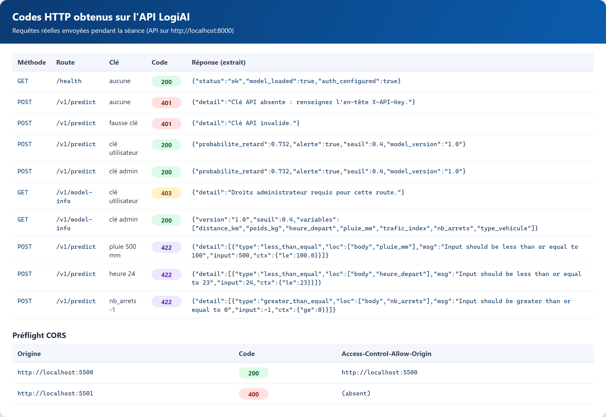
> *Capture 02 — Les différents codes renvoyés par l'API lors des requêtes de sabotage.*

> **Emplacement capture 03**
> 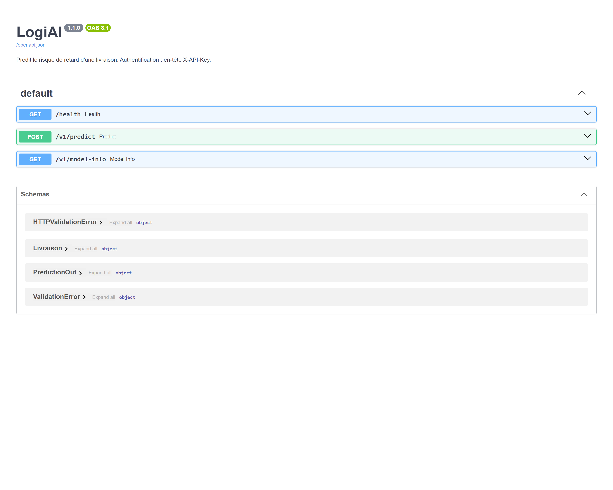
> *Capture 03 — La documentation interactive Swagger UI (`http://localhost:8000/docs`).*

---

## 4. Activité 2 — Les 2 bugs de bornes

### 4.1 Méthode : tester les deux côtés de chaque borne

Pour chaque champ, j'ai testé la **borne basse**, la **borne basse − 1**, la **borne haute** et la
**borne haute + 1**, plus un cas décimal pour les entiers. Ces 28 cas sont densifiés dans
`tests/test_limites.py` sous la forme de la table paramétrée `CAS_LIMITES`.

### 4.2 Les 2 bugs découverts

| Bug | Test qui l'a révélé | Comportement avant | Correction |
|---|---|---|---|
| 1 | `("heure_depart", 24, 422)` | `heure_depart = 24` était accepté (200) alors qu'une heure valide va de 0 à 23 | `heure_depart: int = Field(ge=0, le=23, ...)` |
| 2 | `("nb_arrets", -1, 422)` | `nb_arrets = -1` était accepté (200) car seule la borne haute `le=15` était déclarée | `nb_arrets: int = Field(ge=0, le=15, ...)` |

Le test `("heure_depart", 11.5, 422)` vérifie aussi qu'un entier décimal est refusé.

### 4.3 Extrait du schéma corrigé (`logiai/api/schemas.py`)

```python
distance_km: float = Field(ge=1, le=1000)
poids_kg: float = Field(ge=0.1, le=3500)
heure_depart: int = Field(ge=0, le=23)      # bug 1 corrigé (ge=0 manquait ou le=23)
pluie_mm: float = Field(ge=0, le=100)
trafic_index: float = Field(ge=0, le=10)
nb_arrets: int = Field(ge=0, le=15)         # bug 2 corrigé (ge=0 manquant)
type_vehicule: Literal["moto", "fourgon", "camion"]
```

Le modèle est aussi déclaré avec `model_config = ConfigDict(extra="forbid")` : tout champ
inconnu déclenche une 422.

### 4.4 Sorties de la fin de l'activité 2

```text
$ python -m pytest tests/test_casser.py tests/test_limites.py tests/test_api.py -q
41 passed, 1 warning in ~1.3 s
```

> **Emplacement capture 04**
> 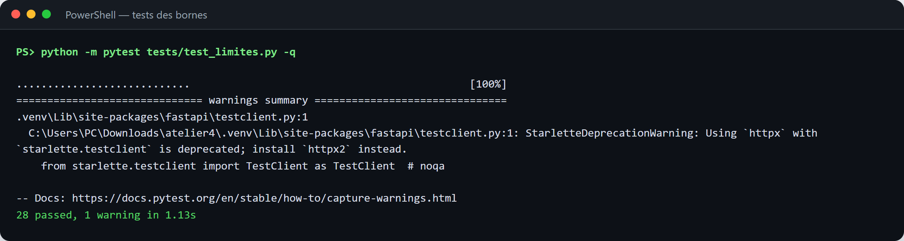
> *Capture 04 — `tests/test_limites.py` : les 28 cas de bornes passent après correction des 2 bugs.*

---

## 5. Sprint 1 — La clé API

### 5.1 Avant / après

Avant ce sprint, `POST /v1/predict` **sans clé** renvoyait `200` : l'API était ouverte à tous.
Après protection, la même requête renvoie `401`.

### 5.2 Fonctions de sécurité (`logiai/api/security.py`)

```python
def _egal(a: str | None, b: str | None) -> bool:
    """Comparaison en temps constant. Une clé non configurée n'est jamais valide."""
    if not a or not b:
        return False
    return secrets.compare_digest(a.encode("utf-8"), b.encode("utf-8"))


def verify_api_key(x_api_key: str | None = Header(default=None)) -> str:
    """Authentification : renvoie le rôle ('user' ou 'admin') ou lève une 401."""
    if not x_api_key:
        raise HTTPException(
            status_code=401,
            detail="Clé API absente : renseignez l'en-tête X-API-Key.",
            headers={"WWW-Authenticate": "ApiKey"},
        )
    if _egal(x_api_key, config.ADMIN_KEY):
        return "admin"
    if _egal(x_api_key, config.API_KEY):
        return "user"
    raise HTTPException(
        status_code=401,
        detail="Clé API invalide.",
        headers={"WWW-Authenticate": "ApiKey"},
    )


def require_admin(role: str = Depends(verify_api_key)) -> str:
    """Autorisation : la clé est valide mais n'a pas forcément les droits (403)."""
    if role != "admin":
        raise HTTPException(status_code=403, detail="Droits administrateur requis pour cette route.")
    return role
```

Protection des routes dans `logiai/api/main.py` :

```python
@app.post("/v1/predict", response_model=PredictionOut, dependencies=[Depends(verify_api_key)])
@app.get("/v1/model-info", dependencies=[Depends(require_admin)])   # réservé à l'admin
@app.get("/health")                                                  # reste public (supervision)
```

### 5.3 Tests de sécurité (`tests/test_securite.py`)

| Requête | Code attendu | Code obtenu |
|---|---|---|
| `/v1/predict` sans clé | 401 | 401 |
| `/v1/predict` fausse clé (`mauvaise-cle`) | 401 | 401 |
| `/v1/predict` clé vide (`""`) | 401 | 401 |
| `/v1/predict` clé utilisateur | 200 | 200 |
| `/v1/predict` clé administrateur | 200 | 200 |
| `/v1/model-info` sans clé | 401 | 401 |
| `/v1/model-info` clé utilisateur | 403 | 403 |
| `/v1/model-info` clé administrateur | 200 | 200 |
| `/health` sans clé | 200 | 200 |

Deux tests supplémentaires verrouillent la sécurité :
`test_la_reponse_401_ne_revele_pas_la_cle` (aucune vraie clé ne fuit dans la réponse) et
`test_sans_configuration_tout_est_refuse` (si `API_KEY`/`ADMIN_KEY` valent `None`, **tout** est refusé : échec sûr).

### 5.4 Les secrets hors du code et hors de Git

Les clés sont lues **exclusivement** depuis l'environnement (`logiai/config.py`) :

```python
API_KEY = os.getenv("LOGIAI_API_KEY")       # clé d'un utilisateur ordinaire
ADMIN_KEY = os.getenv("LOGIAI_ADMIN_KEY")   # clé d'un administrateur
```

- `.env` contient les deux vraies clés (choisies différentes).
- `.env.example` est versionné avec des **valeurs factices**.
- `.env` est ignoré par Git :

```text
$ git status --short
# .env n'apparaît pas dans la liste

$ git check-ignore -v .env
.gitignore:5:.env	.env
```

> **Emplacement capture 05**
> 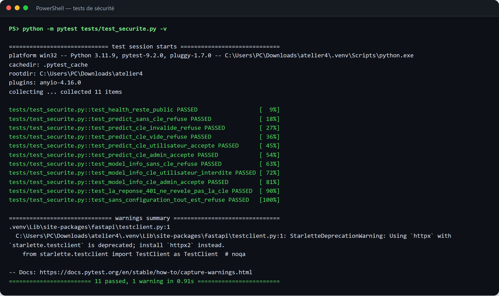
> *Capture 05 — `tests/test_securite.py` : 11 tests (401 sans/fausse/vide clé, 403 utilisateur, 200 admin).*

> **Emplacement capture 06**
> 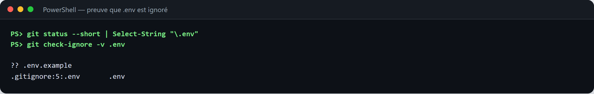
> *Capture 06 — `git status` et `git check-ignore -v .env` prouvent que le fichier de secrets est ignoré.*

---

## 6. Sprint 2 — Le client web

### 6.1 La page et son `fetch` (`web/index.html`)

La page servie par `python -m http.server 5500 --directory web` contient un formulaire (7 champs +
mot de passe « Clé API » saisi à chaque visite, jamais stocké) et appelle l'API :

```javascript
const API_URL = "http://localhost:8000/v1/predict";

async function appelerApi(livraison, cle) {
  const reponse = await fetch(API_URL, {
    method: "POST",
    headers: { "Content-Type": "application/json", "X-API-Key": cle },
    body: JSON.stringify(livraison),
  });
  const corps = await reponse.json();
  return { status: reponse.status, corps };
}
```

Une fonction `messageErreur(status, corps)` traduit les statuts : `401` → « Clé API absente ou
invalide. », `403` → « Vous n'avez pas les droits… », `503` → « service non prêt », `422` →
réponse mise en forme lisible champ par champ (`champ : message`).

### 6.2 Ce qui s'affiche

| Cas testé | Réponse API | Message affiché |
|---|---|---|
| Livraison normale (ex. `livraison.json` : 120 km, 450 kg, 17 h, 8 mm…) | 200 | `Probabilité de retard : 73.2 %. Alerte : livraison à risque.` |
| Pluie de 500 mm | 422 | `Données invalides. pluie_mm : Input should be less than or equal to 100` |
| Clé absente ou fausse | 401 | `Clé API absente ou invalide.` |

### 6.3 Expérience CORS (page servie sur le port 5501)

En déplaçant la page sur `http://localhost:5501` (origine **non autorisée**) :

- la page affiche `API injoignable ou requête bloquée (CORS). Vérifiez qu'uvicorn est lancé et regardez la console F12.` ;
- la console (F12) affiche un message du type :

```text
Access to fetch at 'http://localhost:8000/v1/predict' from origin 'http://localhost:5501'
has been blocked by CORS policy: No 'Access-Control-Allow-Origin' header is present on the
requested resource.
```

- **Pourquoi `curl` marche-t-il quand même ?** CORS est une règle appliquée par le **navigateur**,
  pas par l'API. `curl` n'effectue aucun contrôle CORS : il envoie la requête et lit la réponse.
  La clé API reste indispensable même avec `curl`.
- **Où voyez-vous la clé dans F12 ?** Onglet **Network**, requête `predict`, section
  **Request Headers** : `X-API-Key` est visible en clair. Il faut donc toujours servir la page
  en HTTPS en production et ne jamais écrire la clé dans le JavaScript de la page.

La configuration CORS (`CORSMiddleware`) autorise précisément `http://localhost:5500` et
`http://127.0.0.1:5500`, les méthodes `GET`, `POST`, `OPTIONS` et les en-têtes `Content-Type`,
`X-API-Key`. Une origine `5501` est rejetée (réponse sans en-tête `Access-Control-Allow-Origin`).

> **Emplacement capture 07**
> 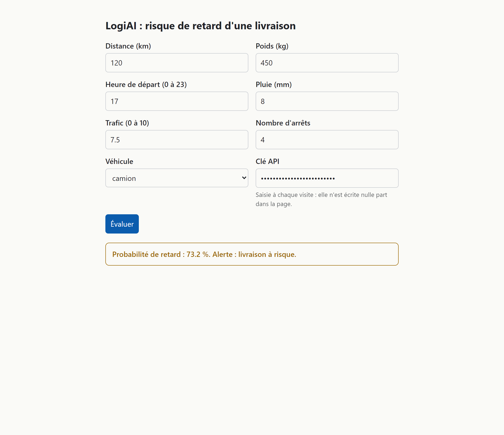
> *Capture 07 — Le formulaire du port 5500 affiche la probabilité de retard (200).*

> **Emplacement capture 08**
> 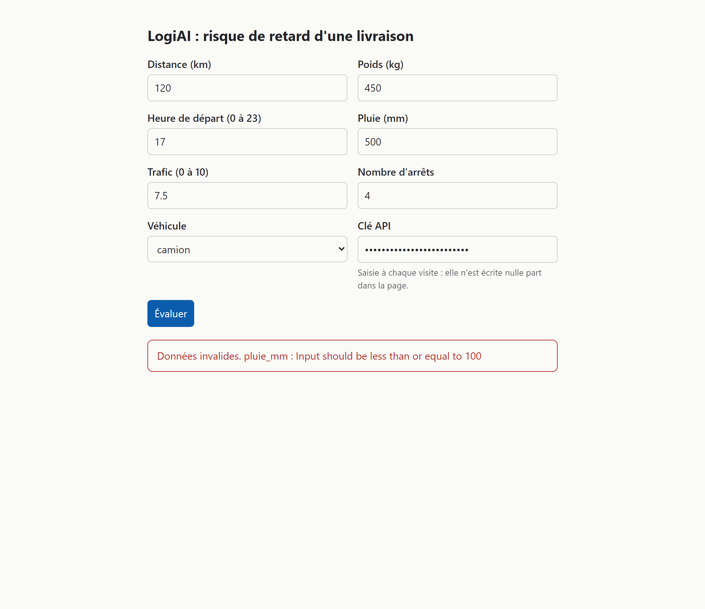
> *Capture 08 — Message d'erreur lisible pour une donnée hors bornes (pluie > 100 mm).*

> **Emplacement capture 09**
> 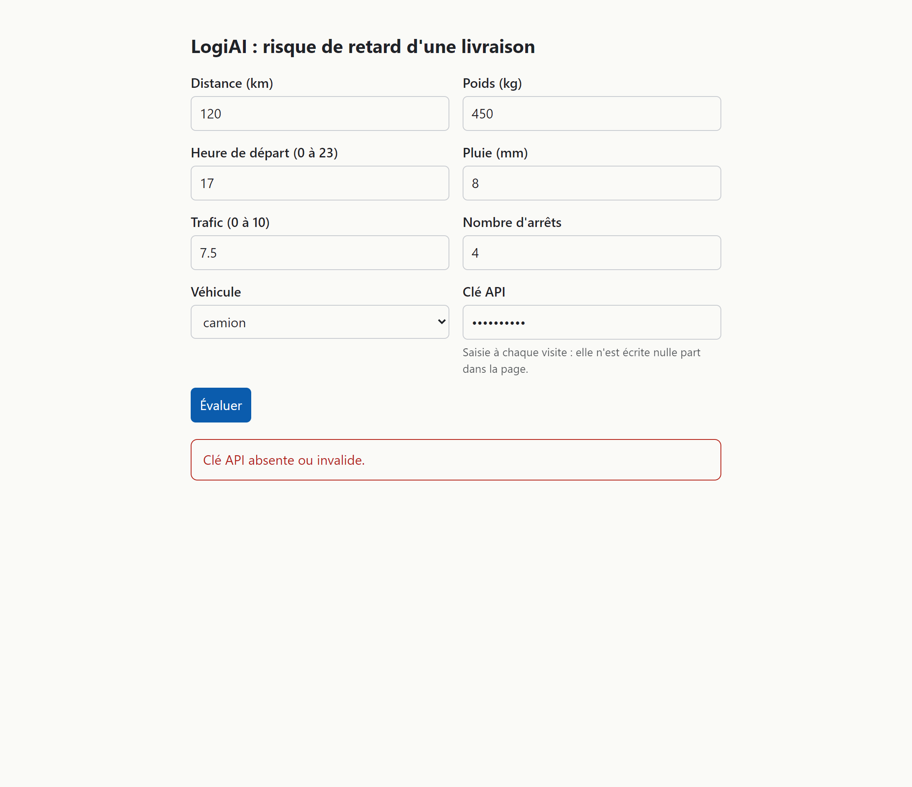
> *Capture 09 — Message affiché quand la clé API est absente ou fausse (401).*

> **Emplacement capture 10**
> 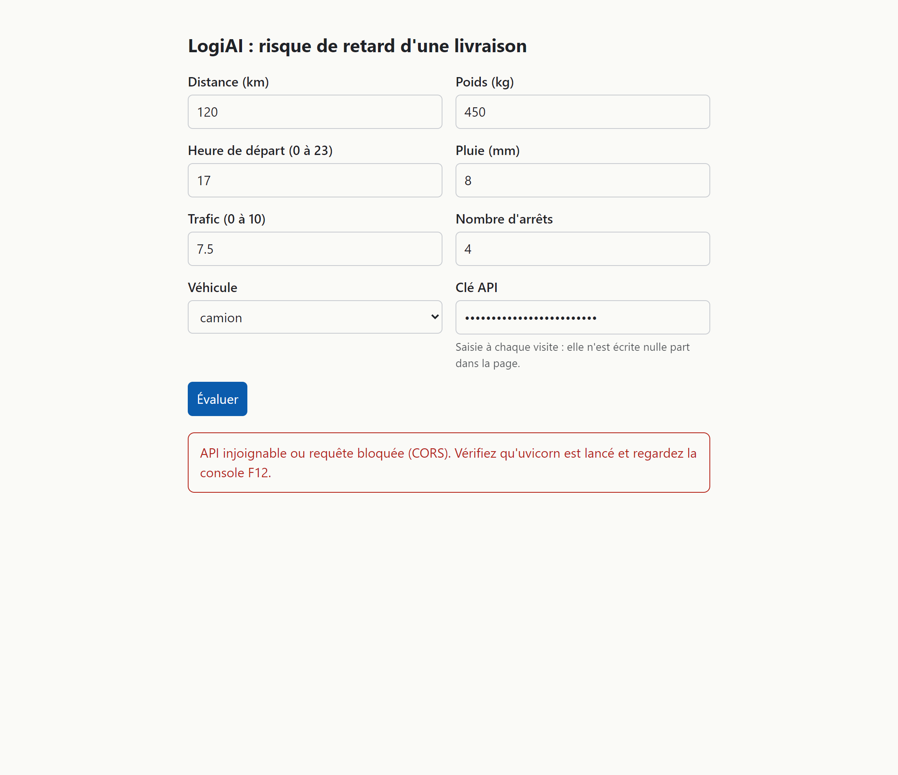
> *Capture 10 — La page servie depuis le port 5501 est bloquée par la politique CORS.*

> **Emplacement capture 11**
> 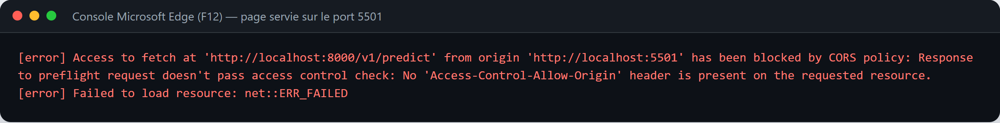
> *Capture 11 — Console F12 : message « blocked by CORS policy » côté navigateur.*

---

## 7. Démonstration via Swagger UI

La documentation interactive `/docs` permet de rejouer manuellement la matrice de sécurité :

| Étape | Action dans Swagger | Réponse |
|---|---|---|
| 1 | Ouvrir `http://localhost:8000/docs` (schémas et routes documentés) | page affichée |
| 2 | `POST /v1/predict` sans authorization | 401 |
| 3 | `POST /v1/predict` avec la clé utilisateur (bouton *Authorize*) | 200 |
| 4 | `GET /v1/model-info` avec la clé utilisateur | 403 |
| 5 | `GET /v1/model-info` avec la clé administrateur | 200 |

> **Emplacement capture 12**
> 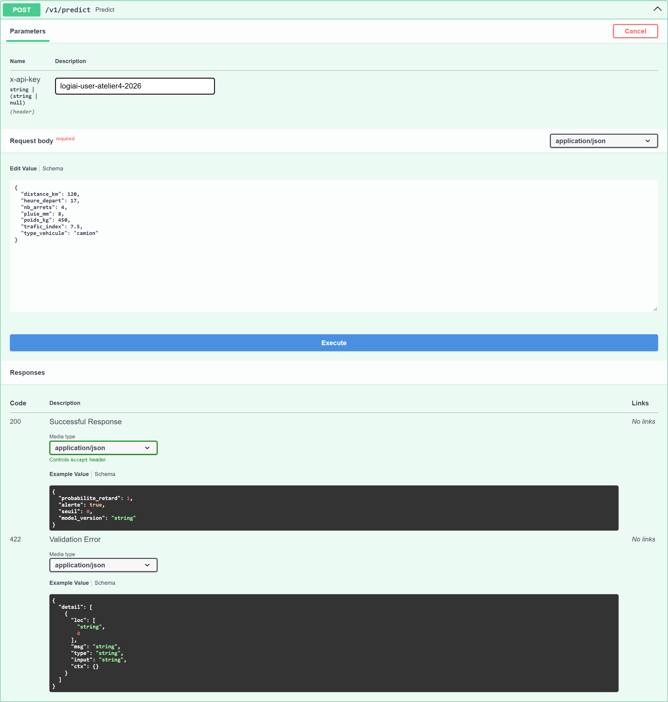
> *Capture 12 — Le formulaire d'exécution de `POST /v1/predict` dans Swagger UI.*

> **Emplacement capture 13**
> 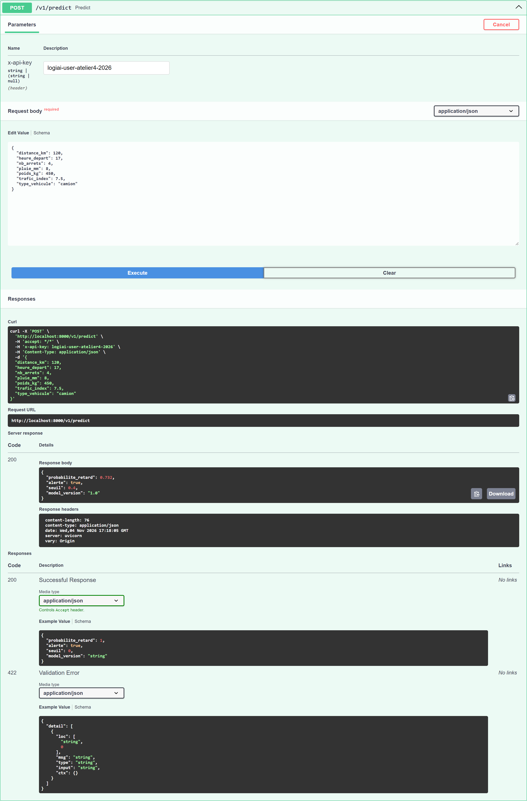
> *Capture 13 — `POST /v1/predict` réussi (200) avec la clé utilisateur et sa réponse.*

> **Emplacement capture 14**
> 
> *Capture 14 — Requête sans clé : réponse 401 « Clé API absente ».*

> **Emplacement capture 15**
> 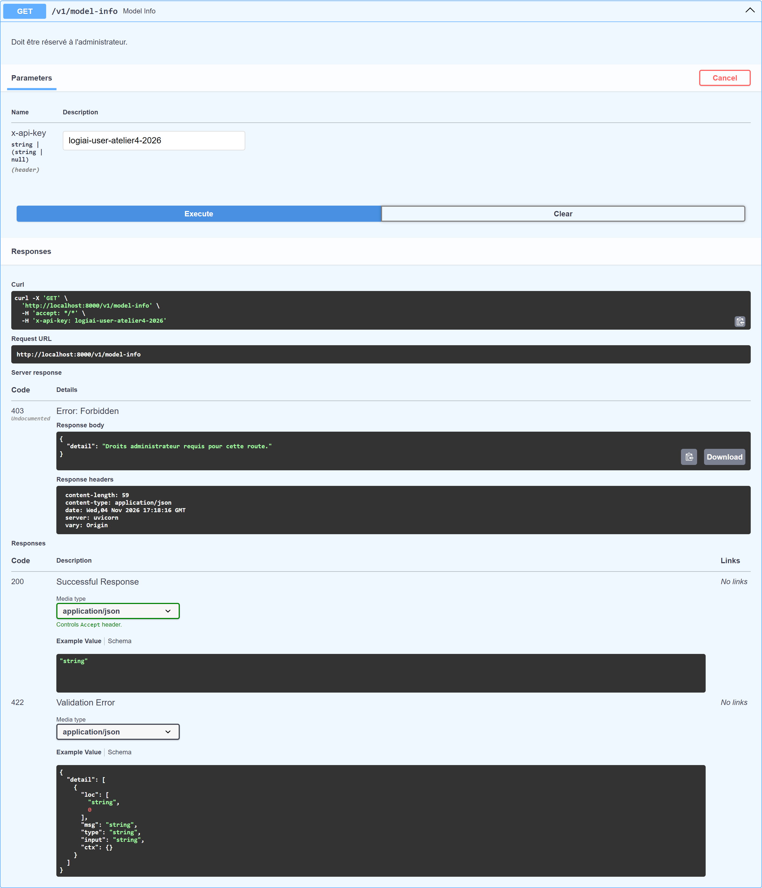
> *Capture 15 — `GET /v1/model-info` avec la clé utilisateur : réponse 403.*

> **Emplacement capture 16**
> 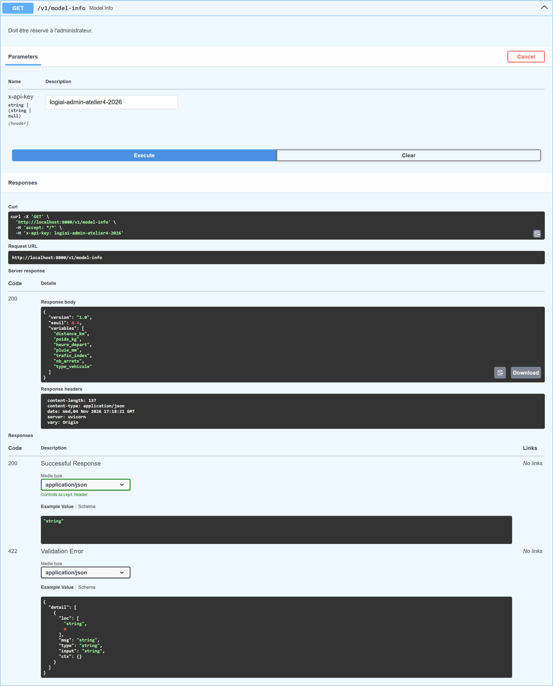
> *Capture 16 — `GET /v1/model-info` avec la clé administrateur : réponse 200 (version, seuil, variables).*

---

## 8. Résultats finaux

```text
$ python -m pytest -q
....................................................                    [100%]
52 passed, 1 warning in 4.38 s
```

Répartition des 52 tests : 5 (`test_casser.py`) + 28 (`test_limites.py`) + 8 (`test_api.py`)
+ 11 (`test_securite.py`).
Le warning est un avertissement de dépréciation interne à `starlette.testclient`, sans effet
sur les résultats.

```text
$ ruff check .
All checks passed!

$ ruff format --check .
All checks passed!
```

| Indicateur | Valeur |
|---|---|
| Tests automatisés | 52 / 52 passés |
| Lint (ruff) | All checks passed |
| Bugs de bornes restants | 0 (`heure_depart ≤ 23`, `nb_arrets ≥ 0`) |
| Routes protégées | `/v1/predict` (401), `/v1/model-info` (403), `/health` public |
| Origines CORS autorisées | `localhost:5500` et `127.0.0.1:5500` uniquement |

> **Emplacement capture 17**
> 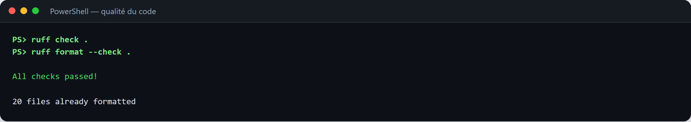
> *Capture 17 — `ruff check .` : « All checks passed! ».*

---

## 9. Questions de compréhension

1. **Quelle différence entre 401, 403 et 422 ?**
   `401 Unauthorized` : le client n'est pas authentifié (clé absente, vide ou fausse).
   `403 Forbidden` : le client est authentifié mais son rôle ne permet pas l'action (clé utilisateur
   sur `/v1/model-info`).
   `422 Unprocessable Entity` : la requête est bien envoyée mais les données ne respectent pas le
   schéma (champ manquant, valeur hors bornes, type incorrect, champ interdit).

2. **Pourquoi la clé n'est-elle ni dans le code ni dans Git ?**
   Tout ce qui est commité **reste dans l'historique Git**, même après suppression du fichier ; la
   clé serait lisible par quiconque accède au dépôt. Le fichier `.env` est lu au démarrage par
   `python-dotenv`, ignoré par `.gitignore`, et en production les secrets sont fournis par
   l'environnement. `.env.example` sert de modèle avec des valeurs factices.

3. **Pourquoi comparer avec `compare_digest` plutôt qu'avec `==` ?**
   `==` s'arrête au premier caractère différent : le temps de réponse peut divulguer le nombre de
   caractères corrects (attaque temporelle). `secrets.compare_digest` compare en **temps constant**
   et ne transmet cette information ni par le temps de réponse ni par le message d'erreur (la
   réponse 401 ne contient jamais la clé).

4. **Pourquoi `curl` fonctionne-t-il alors que la page du port 5501 est bloquée ?**
   Le blocage est appliqué par le navigateur, qui exige un en-tête `Access-Control-Allow-Origin`
   correspondant à l'origine de la page. `curl` n'est pas un navigateur et n'applique pas CORS.
   CORS protège l'utilisateur d'une page malveillante située sur une autre origine, pas l'API
   elle-même ; c'est pourquoi la clé API reste nécessaire dans tous les cas.

5. **Pourquoi la validation faite par le navigateur ne remplace-t-elle pas celle de l'API ?**
   Le navigateur peut vérifier les champs HTML (`required`, `type="number"`), mais n'importe quel
   client peut poster un JSON quelconque avec `curl`, un script ou un autre langage. L'API doit
   donc toujours valider elle-même les données avec Pydantic et ses `Field(ge=…, le=…)` : c'est
   elle, pas le client, qui protège le modèle et les données.

---

## 10. Décisions d'architecture (ADR 003)

Decision record complet : [docs/adr/003-securite.md](docs/adr/003-securite.md).

**Décision 1 — Où transmettre la clé ?** Dans l'en-tête `X-API-Key`.
Dans l'URL, elle serait enregistrée dans les journaux serveur, l'historique du navigateur, les
proxies et l'en-tête `Referer` (un partage de lien suffirait à la divulguer). Dans le corps, elle
serait mêlée aux données métier et recopiée dans les journaux. L'en-tête sépare le secret des
données et permet de vérifier l'identité avant de lire le corps.

**Décision 2 — CORS : liste précise ou `*` ?** Liste précise (`localhost:5500` / `127.0.0.1:5500`,
méthodes `GET`, `POST`, `OPTIONS`, en-têtes `Content-Type`, `X-API-Key`).
Avec `*`, n'importe quel site pourrait lire les réponses de l'API depuis le navigateur d'un
utilisateur ; `*` interdit en plus l'envoi de credentiels et empêche le moindre privilège. Le coût
d'une liste précise : modifier la configuration et redémarrer pour ajouter une origine.

---

## 11. Livraison

- **Dépôt :** https://github.com/younes-boujrada/API-REST-FastAPI
- **Branche de travail :** `tp-securite`
- **Pull request :** https://github.com/younes-boujrada/API-REST-FastAPI/pull/XXXX
  *(à compléter après ouverture de la PR de `tp-securite` vers `main`)*
- **Tag :** `tp2` *(à créer après la fusion de la pull request : `git tag tp2 && git push origin tp2`)*
- **Fichiers livrés :** `logiai/api/{main,schemas,security}.py`, `tests/{conftest,test_casser,
  test_limites,test_securite,test_api}.py`, `web/index.html`, `.env.example`, `.gitignore`,
  `docs/adr/003-securite.md`, captures dans `docs/images/atelier4/`, `COMPTE_RENDU.md`.

---

## 12. Conclusion

L'atelier a transformé une API naïve en une API **défensive et testable** :

- le schéma Pydantic, densifié côté limites, refuse désormais **toutes** les données impossibles
  (5 cas de sabotage + 28 cas de bornes automatisés) ;
- les 2 bugs volontaires (`heure_depart = 24`, `nb_arrets = -1`) ont été détectés par les tests puis corrigés ;
- l'API distingue clairement **qui appelle** (401/403 via `X-API-Key` + rôles) de **ce qui est
  envoyé** (422), et échoue en mode sûr sans configuration ;
- les secrets vivent dans `.env` hors de Git, et le navigateur ne peut appeler l'API que depuis
  l'origine légitime (CORS restreint) ;
- la suite de `52 tests` + `ruff` forme un filet de sécurité qui rejoue l'intégralité de ces
  règles à chaque `python -m pytest`.

Perspectives proposées : limiter le débit (rate limiting) sur `/v1/predict`, journaliser les
tentatives 401/403, et remplacer la clé statique par des tokens courts (OAuth2/JWT) pour la mise
en production.

---
*BOUJRADA Younes — Atelier 4 — LogiAI : tester, sécuriser et appeler l'API.*
