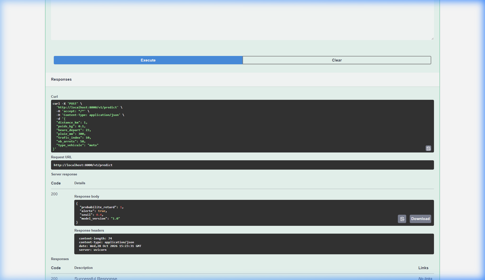
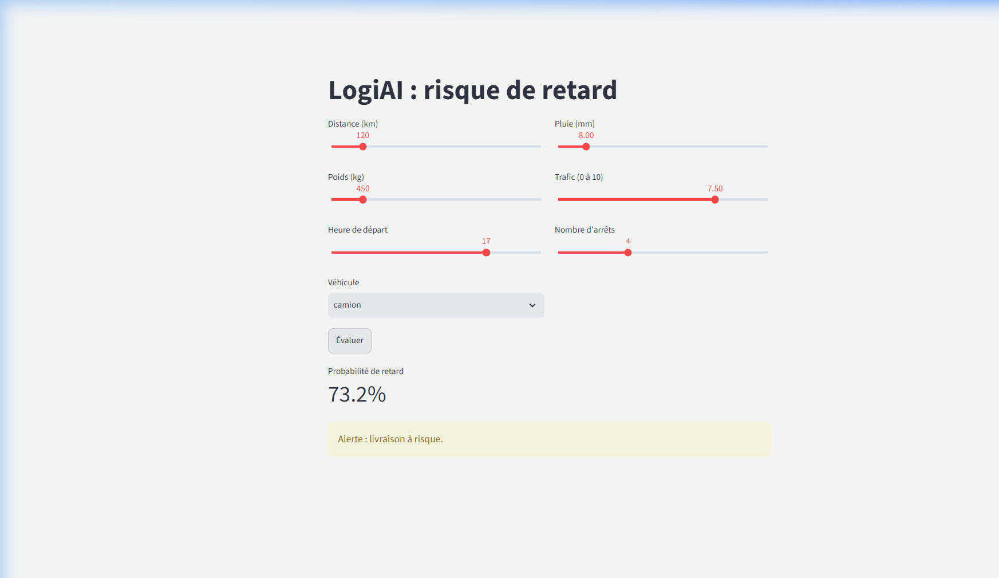

# Compte rendu : TP API LogiAI

**Nom et Prénom :** BOUJRADA Younes  
**Module :** Développement et déploiement d’applications intelligentes  
**Année Universitaire :** 2026 - 2027  

---

## 1. Environnement et premiers tests

- **Sortie de `python -m pytest` au départ :**
```text
================================================= test session starts =================================================
platform win32 -- Python 3.11.9, pytest-9.2.0, pluggy-1.7.0
rootdir: C:\Users\PC\Downloads\logiai_starter\starter
plugins: anyio-4.15.1
collected 13 items                                                                                                     

tests\test_api.py ..FFFF......F                                                                                  [100%]

====================================================== FAILURES ======================================================= 
FAILED tests/test_api.py::test_predict_valide_renvoie_200 - assert 422 == 200
FAILED tests/test_api.py::test_predict_forme_de_la_reponse - AssertionError: assert {'detail'} == {'alerte', 'model_version', 'probabilite_retard', 'seuil'}
FAILED tests/test_api.py::test_predict_probabilite_entre_0_et_1 - KeyError: 'probabilite_retard'
FAILED tests/test_api.py::test_predict_trajet_risque_plus_eleve_que_trajet_facile - KeyError: 'probabilite_retard'
FAILED tests/test_api.py::test_modele_absent_renvoie_503 - assert 422 == 503
======================================= 5 failed, 8 passed, 1 warning in 3.48s ========================================
```

- **Performances initiales du modèle (`python -m logiai.train`) :**
  - **Baseline accuracy** : 0.726 (72.6 % en prédisant toujours « à l'heure »)
  - **Accuracy du modèle** : 0.774 (77.4 %)
  - **Rappel du modèle** : 0.464 (46.4 %)
  - **Précision** : 0.617 (61.7 %)
  - **AUC ROC** : 0.769
  - *Interprétation du rappel* : Sur 100 livraisons réellement en retard, environ 46 sont détectées par le modèle. Même si le rappel est modéré, l'API est très utile pour un dispatcher car elle permet de prioriser les interventions sur près de la moitié des retards critiques au lieu de subir 100 % des imprévus.

- **Pourquoi certains tests qui attendent un 422 passent-ils déjà, alors que rien n'est écrit ?**  
  Le schéma `Livraison` contenait la configuration `model_config = ConfigDict(extra="forbid")` et aucun champ n'était encore déclaré (hormis `distance_km`). Par conséquent, tout champ envoyé dans la requête était considéré comme inconnu et rejeté automatiquement par Pydantic avec un statut **422 Unprocessable Entity**. Les tests attendant 422 passaient donc par "faux positif" car tout était refusé, même les requêtes valides.

---

## 2. Mon schéma

- **Mes bornes et leur justification physique (une ligne par variable) :**

| Variable | Min | Max | Pourquoi |
|---|---|---|---|
| `distance_km` | 1 | 1000 | Trajet d'au moins 1 km en ville jusqu'à 1000 km pour une liaison routière nationale. |
| `poids_kg` | 0.1 | 30000 | D'un pli/colis léger en moto (100 g) jusqu'à la charge utile maximale d'un camion lourd (30 t). |
| `heure_depart` | 0 | 23 | Heure de la journée sur une plage de 24 heures (0h00 à 23h59). |
| `pluie_mm` | 0 | 300 | Temps sec (0 mm) jusqu'à des conditions d'orages violents ou précipitations extrêmes (300 mm). |
| `trafic_index` | 0 | 10 | Échelle d'indice normalisée définie dans le contrat LogiAI (0 = circulation fluide, 10 = réseau saturé). |
| `nb_arrets` | 0 | 50 | Trajet direct sans escale (0) jusqu'à une tournée de distribution urbaine intensive (50 arrêts). |

```python
class Livraison(BaseModel):
    model_config = ConfigDict(extra="forbid")

    distance_km: float = Field(ge=1, le=1000, description="Distance du trajet (km)")
    poids_kg: float = Field(ge=0.1, le=30000, description="Poids transporté en kg")
    heure_depart: int = Field(ge=0, le=23, description="Heure de départ (0 à 23)")
    pluie_mm: float = Field(ge=0, le=300, description="Pluie prévue sur le trajet en mm")
    trafic_index: float = Field(ge=0, le=10, description="Indice de trafic (0=fluide, 10=saturé)")
    nb_arrets: int = Field(ge=0, le=50, description="Nombre d'arrêts de livraison prévus")
    type_vehicule: Literal["moto", "fourgon", "camion"] = Field(description="Type de véhicule utilisé")
```

---

## 3. Ma fonction predict()

```python
@app.post("/v1/predict", response_model=PredictionOut)
def predict(livraison: Livraison):
    predictor = state.get("predictor")
    if predictor is None:
        raise HTTPException(
            status_code=503,
            detail="Modèle non chargé. Veuillez vérifier la présence du modèle ou ré-entraîner avec python -m logiai.train"
        )
    resultat = predictor.predict(livraison.model_dump())
    return PredictionOut(**resultat)
```

---

## 4. Quatre requêtes

| Requête | Code obtenu | Pourquoi |
|---|---|---|
| livraison normale | **200 OK** | Données conformes au contrat de l'API et modèle disponible en mémoire. |
| `distance_km = -5` | **422 Unprocessable Entity** | Distance négative invalide violant la règle de validation `ge=1` du schéma Pydantic. |
| `type_vehicule = "avion"` | **422 Unprocessable Entity** | Valeur non permise par l'énumération `Literal["moto", "fourgon", "camion"]`. |
| modèle absent (dossier `models/` absent) | **503 Service Unavailable** | `state.get("predictor")` renvoie `None` ; l'API intercepte l'absence et lève une `HTTPException(503)`. |

### Capture d'écran Swagger UI (/docs) :


---

## 5. Questions de compréhension

1. **Pourquoi charge-t-on le modèle au démarrage et pas à chaque requête ?**  
   Charger un modèle sérialisé (`joblib`) depuis le disque implique des accès disques (I/O) et une désérialisation lourde. Le charger une seule fois au démarrage (via le cycle de vie `lifespan`) et le conserver en mémoire RAM permet à l'API de répondre à chaque requête en quelques millisecondes sans saturer le processeur.

2. **Qui écrit le contrôle « pluie <= 100 » (ou 300), et où est-il écrit ?**  
   C'est le développeur qui l'écrit dans le schéma Pydantic (`logiai/api/schemas.py`) dans l'argument `le=...` de `Field(...)`. FastAPI et Pydantic se chargent ensuite d'exécuter automatiquement cette validation dès réception du JSON, avant même d'atteindre le code de la route.

3. **Différence entre 422 et 503 ?**  
   - **422 (Unprocessable Entity)** : Erreur côté **client** (le client a envoyé des données erronées ou non conformes au schéma).  
   - **503 (Service Unavailable)** : Erreur côté **serveur** (le serveur fonctionne mais ne peut pas rendre le service demandé car sa dépendance, le modèle, n'est pas disponible).

4. **Pourquoi une route `/v1/predict` plutôt que `/predict` ?**  
   Le versionnement dans l'URL (`/v1`) permet de faire évoluer l'API dans le futur (ex: modification du schéma d'entrée dans une future `/v2`) sans casser le fonctionnement des clients existants (applications mobiles, partenaires).

5. **Que se passerait-il si la distance était déclarée `int` ?**  
   Une distance avec une partie décimale (par exemple `12.5` km) provoquerait une erreur de validation 422 ou une troncature / conversion forcée, ce qui dégraderait la précision des prédictions.

---

## 6. Décision : modèle absent

**Répondre 503 ou refuser de démarrer ? Qu'est-ce que chaque option fait perdre ?**

- **Option A (Démarrer et répondre 503 aux prédictions) :**  
  - *Avantages* : L'API reste accessible, l'endpoint de diagnostic `/health` répond `{"status": "ok", "model_loaded": false}`, et `/docs` reste consultable. L'équipe d'infrastructure peut auditer l'état du conteneur sans qu'il crashe en boucle.  
  - *Ce qu'on perd* : Les utilisateurs qui appellent `/v1/predict` reçoivent une erreur 503 au lieu d'un service opérationnel.

- **Option B (Refuser de démarrer / Crash au démarrage) :**  
  - *Avantages* : Approche « fail-fast ». Un orchestrateur comme Kubernetes détecte immédiatement l'échec et ne bascule pas le trafic utilisateur sur ce pod.  
  - *Ce qu'on perd* : Plus d'endpoint `/health` ni de `/docs` pour inspecter la machine ; le conteneur entre en boucle d'erreur (`CrashLoopBackOff`).

---

## 7. Tests de robustesse et Banc d'essai (Bloc 6)

### Sortie de `python -m pytest` (15 passed) :
```text
============================= test session starts =============================
platform win32 -- Python 3.11.9, pytest-9.2.0, pluggy-1.7.0
rootdir: C:\Users\PC\Downloads\logiai_starter\starter
plugins: anyio-4.15.1
collected 15 items

tests\test_api.py ...............                                        [100%]

======================== 15 passed, 1 warning in 2.99s ========================
```

### Les deux tests ajoutés :
```python
def test_heure_24_refusee():
    with TestClient(app) as client:
        assert post(client, heure_depart=24).status_code == 422


def test_alerte_coherente_avec_le_seuil():
    difficile = dict(
        distance_km=479, poids_kg=2040, heure_depart=17,
        pluie_mm=46, trafic_index=10, nb_arrets=4, type_vehicule="camion"
    )
    facile = dict(
        distance_km=5, poids_kg=3, heure_depart=11,
        pluie_mm=0, trafic_index=1, nb_arrets=0, type_vehicule="moto"
    )
    with TestClient(app) as client:
        res_difficile = post(client, **difficile).json()
        res_facile = post(client, **facile).json()
        assert res_difficile["alerte"] is True
        assert res_facile["alerte"] is False
```

---

## 8. Client Streamlit (Bloc 7)

- **Capture d'écran de l'application Streamlit :**


- **Comportement lorsque l'API est arrêtée :**  
  Lorsque `uvicorn` est interrompu et qu'on clique sur « Évaluer », Streamlit intercepte l'exception `requests.ConnectionError` et affiche le message d'erreur rouge :  
  `"API injoignable : lancez uvicorn dans un autre terminal."`

- **Question de réflexion :** *Ce Streamlit n'importe plus ni scikit-learn ni le modèle. Qu'est-ce que cela change si une application mobile doit, elle aussi, utiliser la prédiction ?*  
  Cela change tout en termes d'architecture : l'application cliente (mobile, web ou dashboard) n'a plus besoin d'embarquer des dépendances lourdes (Python, scikit-learn, poids du modèle en Mo), ni d'avoir une grande puissance de calcul. Elle se contente d'envoyer une requête HTTP légère en JSON et de recevoir la réponse. De plus, toute mise à jour du modèle sur le serveur bénéficie instantanément à tous les clients sans nécessiter de mise à jour sur les stores d'applications mobiles.

---

## 9. Ticket de sortie

1. **Quel code renvoie l'API pour une pluie de 500 mm, et qui écrit ce contrôle ?**  
   L'API renvoie le code **422 Unprocessable Entity**. Ce contrôle est écrit par le développeur dans le schéma Pydantic (`logiai/api/schemas.py`) via `Field(le=300)`.

2. **Pourquoi charge-t-on le modèle au démarrage et pas à chaque requête ?**  
   Pour éviter la latence d'I/O disque et de désérialisation du fichier `.joblib` à chaque appel HTTP, ce qui garantit un temps de réponse rapide (quelques millisecondes).

3. **Lien de la pull request :**  
   *(Lien de votre Pull Request depuis la branche `tp-api` vers `main` sur GitHub)*
