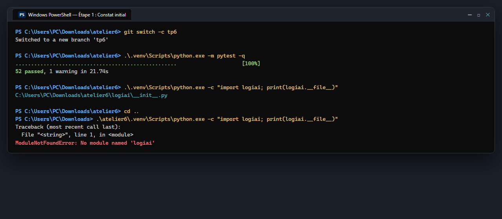
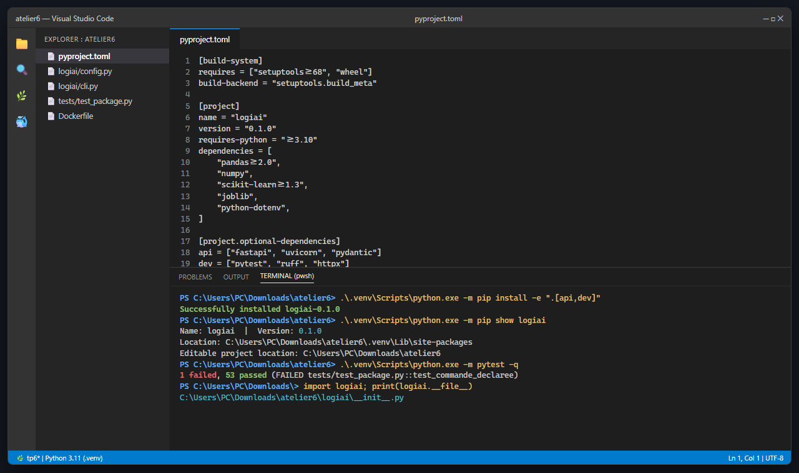
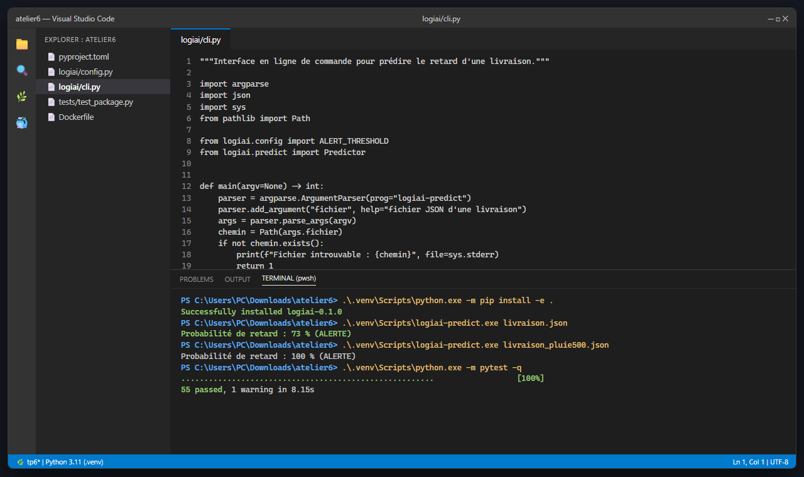
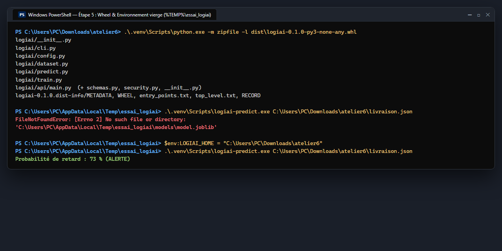
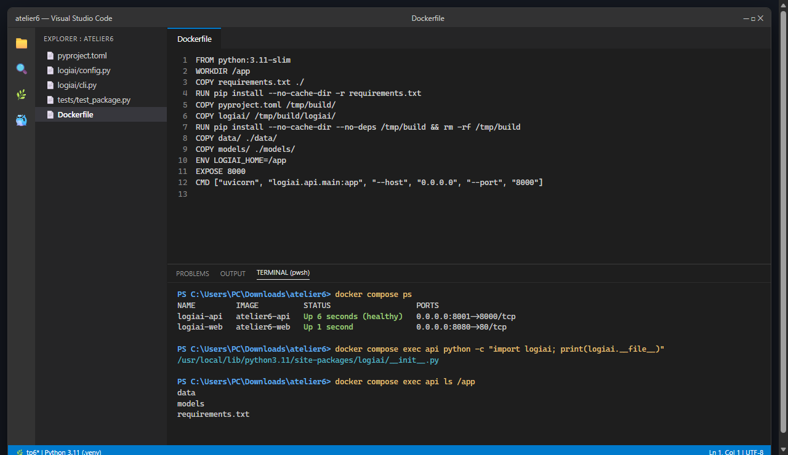
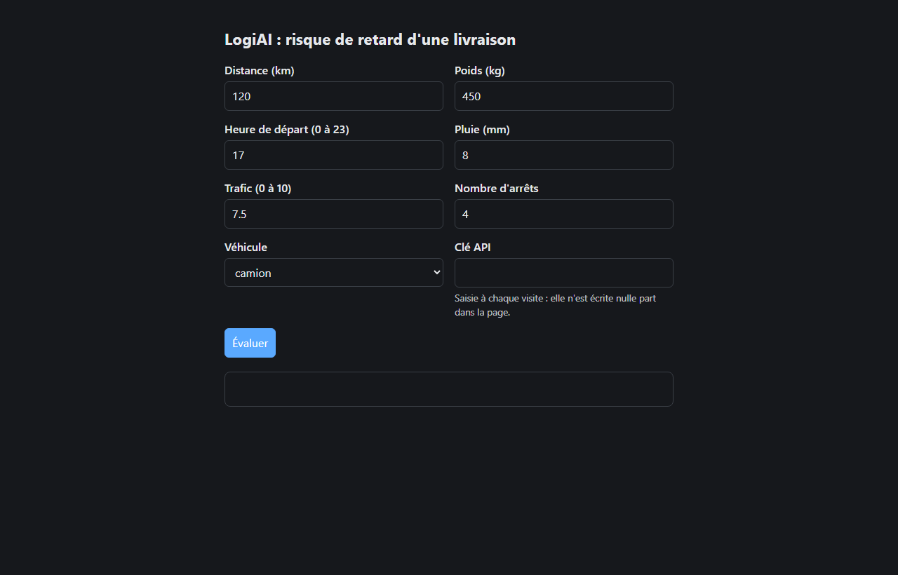
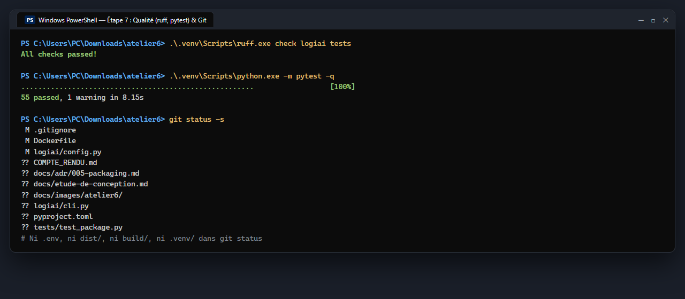

# Compte rendu — Atelier 6 : Faire de LogiAI un package

**Nom et prénom :** BOUJRADA Younes  
**Groupe :** ............................  
**Module :** Développement et déploiement d'applications intelligentes (Pr. Soukaina Gouraguine)  
**Année universitaire :** 2026 - 2027  
**Livrable :** Package Python `logiai` (`pyproject.toml`, CLI `logiai-predict`, wheel, intégration Docker), `docs/adr/005-packaging.md`, `docs/etude-de-conception.md` et rapport PDF avec captures (`COMPTE_RENDU_ATELIER6_BOUJRADA_Younes.pdf`)

---

## Table des matières

1. [Contexte et objectifs](#1-contexte-et-objectifs)
2. [Étape 1 — Constater le problème (« ça ne marche que dans son dossier »)](#2-étape-1--constater-le-problème--ça-ne-marche-que-dans-son-dossier-)
3. [Étape 2 — Écrire la fiche `pyproject.toml` et les tests du package](#3-étape-2--écrire-la-fiche-pyprojecttoml-et-les-tests-du-package)
4. [Étape 3 — Installer LogiAI en mode éditable](#4-étape-3--installer-logiai-en-mode-éditable)
5. [Étape 4 — Créer la commande `logiai-predict` et comparer CLI vs API (`pluie_mm = 500`)](#5-étape-4--créer-la-commande-logiai-predict-et-comparer-cli-vs-api-pluie_mm--500)
6. [Étape 5 — Construire le wheel et le livrer à un collègue](#6-étape-5--construire-le-wheel-et-le-livrer-à-un-collègue)
7. [Étape 6 — Installer le package dans l'image Docker](#7-étape-6--installer-le-package-dans-limage-docker)
8. [Étape 7 — ADR 005, Étude de conception et livraison Git](#8-étape-7--adr-005-étude-de-conception-et-livraison-git)
9. [Ticket de sortie](#9-ticket-de-sortie)

---

## 1. Contexte et objectifs

À l'issue de l'**Atelier 5**, LogiAI était conteneurisé avec Docker et Docker Compose, mais le code Python restait un simple dossier `logiai/` copié manuellement (`COPY logiai/ ./logiai/`), utilisable uniquement depuis la racine du projet. L'**Atelier 6** transforme `logiai` en un **véritable package Python** installable (`pip install -e .` ou via un fichier `.whl`), doté d'une commande terminal `logiai-predict`, indépendant de son répertoire d'exécution grâce à `LOGIAI_HOME`, et proprement installé dans `site-packages` au sein de l'image Docker.

| Étape | Ce qui est réalisé |
|---|---|
| 1. Constat | Vérification que `import logiai` fonctionne à la racine mais échoue avec `ModuleNotFoundError` hors du dossier |
| 2. `pyproject.toml` | Déclaration du package `logiai` (`0.1.0`), de ses dépendances et de `tests/test_package.py` |
| 3. Mode éditable | `pip install -e ".[api,dev]"`, `pip show logiai`, validation de l'import depuis le dossier parent |
| 4. Commande CLI | Création de `logiai/cli.py`, déclaration de `logiai-predict`, test sur `livraison.json` et cas `pluie_mm = 500` |
| 5. Wheel & livraison | Build `logiai-0.1.0-py3-none-any.whl`, `ROOT` via `LOGIAI_HOME` dans `config.py`, test en venv vierge |
| 6. Docker | Mise à jour du `Dockerfile` (`--no-deps /tmp/build`), vérification `site-packages` et `/app` |
| 7. Rendre | Rédaction de `docs/adr/005-packaging.md`, `docs/etude-de-conception.md` (architecture), `COMPTE_RENDU.md`, PR et tag `tp6` |

---

## 2. Étape 1 — Constater le problème (« ça ne marche que dans son dossier »)

Après création de la branche `tp6` et vérification des 52 tests initiaux (`52 passed`), on teste l'import de `logiai` depuis la racine du projet puis depuis le dossier parent (`..`) :

```text
PS C:\Users\PC\Downloads\atelier6> .\.venv\Scripts\python.exe -c "import logiai; print(logiai.__file__)"
C:\Users\PC\Downloads\atelier6\logiai\__init__.py

PS C:\Users\PC\Downloads\atelier6> cd ..
PS C:\Users\PC\Downloads\atelier6> ..\.venv\Scripts\python.exe -c "import logiai; print(logiai.__file__)"
Traceback (most recent call last):
  File "<string>", line 1, in <module>
ModuleNotFoundError: No module named 'logiai'
```

**Réponse attendue (Étape 1) :**  
> *« Pour utiliser LogiAI, mon collègue doit se placer impérativement dans le dossier racine du projet (ou ajouter ce dossier à `PYTHONPATH`), car Python ne connaît `logiai` que via le répertoire courant et non comme un package installé dans son environnement. »*


*Capture 01 — Terminal Windows : les 52 tests initiaux passent et l'import de `logiai` échoue hors du répertoire du projet (`ModuleNotFoundError`).*

---

## 3. Étape 2 — Écrire la fiche `pyproject.toml` et les tests du package

Le fichier `pyproject.toml` est créé à la racine du projet. Après inspection des imports de `logiai/` (`config.py`, `dataset.py`, `predict.py`, `train.py`), `python-dotenv` est ajouté aux dépendances principales aux côtés de `pandas>=2.0`, `numpy`, `scikit-learn>=1.3` et `joblib`. Les extras `api` (`fastapi`, `uvicorn`, `pydantic`) et `dev` (`pytest`, `ruff`, `httpx`) sont déclarés, ainsi que `[tool.setuptools.packages.find]` (`include = ["logiai*"]`).

Le fichier `tests/test_package.py` est créé avec `test_package_installe` et `test_commande_declaree`. Avant installation, `python -m pytest` donne :

```text
2 failed, 52 passed, 1 warning in 33.40s
FAILED tests/test_package.py::test_package_installe - PackageNotFoundError: No package metadata was found for logiai
FAILED tests/test_package.py::test_commande_declaree - AssertionError: assert 'logiai-predict' in {...}
```

---

## 4. Étape 3 — Installer LogiAI en mode éditable

L'installation en mode éditable (`python -m pip install -e ".[api,dev]"`) enregistre `logiai` dans `.venv\Lib\site-packages` tout en pointant vers le dossier source :

```text
PS C:\Users\PC\Downloads\atelier6> .\.venv\Scripts\python.exe -m pip show logiai
Name: logiai
Version: 0.1.0
Location: C:\Users\PC\Downloads\atelier6\.venv\Lib\site-packages
Editable project location: C:\Users\PC\Downloads\atelier6
Requires: joblib, numpy, pandas, python-dotenv, scikit-learn
```

- `python -m pytest` : **1 seul test échoue** (`test_commande_declaree`), les **53 autres tests passent**.
- Depuis le dossier parent (`..`), `import logiai` fonctionne désormais et affiche `C:\Users\PC\Downloads\atelier6\logiai\__init__.py`.


*Capture 02 — VS Code : édition de `pyproject.toml` et `tests/test_package.py`, puis terminal intégré montrant `pip show logiai`, `1 failed, 53 passed` et l'import réussi depuis le dossier parent.*

---

## 5. Étape 4 — Créer la commande `logiai-predict` et comparer CLI vs API (`pluie_mm = 500`)

Le module `logiai/cli.py` importe `Predictor` depuis `logiai.predict` et `ALERT_THRESHOLD` depuis `logiai.config`, lit le fichier JSON passé en argument, calcule la probabilité de retard et affiche :

```text
PS C:\Users\PC\Downloads\atelier6> .\.venv\Scripts\logiai-predict.exe livraison.json
Probabilité de retard : 73 % (ALERTE)

PS C:\Users\PC\Downloads\atelier6> .\.venv\Scripts\python.exe -m pytest -q
55 passed, 1 warning in 8.15s
```

### Question à noter : que se passe-t-il avec `pluie_mm = 500` ?

- **Réponse de la commande CLI (`logiai-predict`) :**  
  `Probabilité de retard : 100 % (ALERTE)` (code de retour `0`).
- **Réponse de l'API (`POST /v1/predict`) :**  
  Erreur HTTP **`422 Unprocessable Entity`** :  
  `{"detail":[{"type":"less_than_equal","loc":["body","pluie_mm"],"msg":"Input should be less than or equal to 100","input":500,"ctx":{"le":100.0}}]}`.
- **Pourquoi ?**  
  L'API valide les entrées avec le schéma Pydantic `Livraison` (`logiai/api/schemas.py`), qui impose la contrainte métier `pluie_mm: float = Field(ge=0, le=100)`. La commande CLI `logiai-predict` passe directement le dictionnaire JSON à `Predictor().predict(livraison)` sans validation Pydantic : `scikit-learn` calcule donc une prédiction mathématique (`~100 %`) même pour une valeur physiquement aberrante.


*Capture 03 — VS Code : implémentation de `logiai/cli.py`, exécution de `logiai-predict livraison.json` (`73 % (ALERTE)`), test `pluie_mm = 500` (`100 % (ALERTE)`) et `55 passed` sous `pytest`.*

---

## 6. Étape 5 — Construire le wheel et le livrer à un collègue

### 6.1 Construction et inspection du wheel (5a)
Après installation de `build`, `python -m build` génère `dist/logiai-0.1.0-py3-none-any.whl`. L'inspection via `python -m zipfile -l` confirme que seul le dossier `logiai/` et ses métadonnées `logiai-0.1.0.dist-info/` sont présents (ni `models/`, ni `data/`, ni `tests/`, ni `.env`).

### 6.2 Correction de `ROOT` avec `LOGIAI_HOME` (5b)
Dans `logiai/config.py`, la racine du projet est désormais définie par :
```python
ROOT = Path(os.environ.get("LOGIAI_HOME", Path.cwd()))
```
Les 55 tests `pytest` restent tous verts.

### 6.3 Test dans un environnement vierge (5c)
Dans `%TEMP%\essai_logiai`, un environnement virtuel `.venv` neuf est créé et le wheel y est installé :

1. **Premier lancement (sans `LOGIAI_HOME`) :** échoue avec le message exact :
   ```text
   FileNotFoundError: [Errno 2] No such file or directory:
   'C:\\Users\\PC\\AppData\\Local\\Temp\\essai_logiai\\models\\model.joblib'
   ```
2. **Deuxième lancement (avec `LOGIAI_HOME=C:\Users\PC\Downloads\atelier6`) :** réussit et affiche :
   ```text
   Probabilité de retard : 73 % (ALERTE)
   ```


*Capture 04 — Terminal Windows : contenu du wheel (`zipfile -l`), échec `FileNotFoundError` sans `LOGIAI_HOME` dans `%TEMP%\essai_logiai`, puis prédiction réussie avec `LOGIAI_HOME`.*

---

## 7. Étape 6 — Installer le package dans l'image Docker

Dans `Dockerfile`, la copie brute `COPY logiai/ ./logiai/` est remplacée par une installation propre du package depuis `/tmp/build` avec `--no-deps` :

```dockerfile
COPY pyproject.toml /tmp/build/
COPY logiai/ /tmp/build/logiai/
RUN pip install --no-cache-dir --no-deps /tmp/build && rm -rf /tmp/build
```

Après `docker compose up -d --build`, les vérifications dans le conteneur `logiai-api` donnent :

- `docker compose ps` : `logiai-api` est **`Up (healthy)`** (`8001:8000`) et `logiai-web` est **`Up`** (`8080:80`).
- **Chemin de `logiai` dans le conteneur :**
  ```text
  $ docker compose exec api python -c "import logiai; print(logiai.__file__)"
  /usr/local/lib/python3.11/site-packages/logiai/__init__.py
  ```
- **Contenu de `/app` dans le conteneur :**
  ```text
  $ docker compose exec api ls /app
  data
  models
  requirements.txt
  ```
  Le dossier source `logiai/` n'est plus dans `/app`.
- **Vérifications HTTP :** sans clé API → **`401`**, avec clé API → **`200`** (`{"probabilite_retard":0.732,"alerte":true,"seuil":0.4,"model_version":"1.0"}`), avec `pluie_mm=500` → **`422`**, et la page web sur `http://localhost:8080` répond **`200`** et prédit normalement.


*Capture 05 — VS Code & Terminal Windows : `Dockerfile` mis à jour, `docker compose ps` (`healthy`), `logiai.__file__` dans `site-packages` et `ls /app` sans dossier `logiai/`.*


*Capture 06 — Navigateur Windows : interface web LogiAI sur `http://localhost:8080` prédisant le risque de retard via le reverse proxy Nginx et le package `logiai` installé dans `site-packages`.*

---

## 8. Étape 7 — ADR 005, Étude de conception et livraison Git

- **ADR 005 ([`docs/adr/005-packaging.md`](docs/adr/005-packaging.md)) :** justifie l'usage de `>=` dans `pyproject.toml` vs `==` dans `requirements.txt`, ainsi que la séparation du modèle (`models/`) hors du wheel.
- **Étude de conception ([`docs/etude-de-conception.md`](docs/etude-de-conception.md)) :** créée avec les 9 sections réglementaires et la section **Architecture** rédigée avec le schéma complet (données, modèle, package `logiai`, API, Nginx, page web, commande CLI et conteneurs).
- **Qualité et Git :** `.gitignore` exclut `.env`, `dist/`, `build/`, `*.egg-info/` et `.venv/`. `ruff check logiai tests` passe (`All checks passed!`) et `pytest` passe (`55 passed`).


*Capture 07 — Terminal Windows : `git status` sans fichiers sensibles/artefacts de build, `ruff check logiai tests` (`All checks passed!`) et `55 passed` sous `pytest`.*

---

## 9. Ticket de sortie

1. **Docker et le package : quelle différence ?**  
   Le **package Python** (`logiai`) regroupe uniquement le code Python et ses métadonnées pour être importé ou exécuté dans n'importe quel environnement Python (via `pip`). **Docker** empaquette l'environnement complet du système d'exécution (OS Linux, interpréteur Python 3.11, dépendances système/Python, configuration, serveur web/API) afin de garantir un comportement identique sur toute machine.
2. **`pip install -e .` ou wheel : lequel pour développer, lequel pour livrer ?**  
   **`pip install -e .`** (mode éditable) sert à **développer**, car toute modification du code source est immédiatement prise en compte sans réinstaller. Le **wheel** (`.whl`) sert à **livrer** une version figée, prête à être installée rapidement chez un collègue ou dans un conteneur sans code source superflu.
3. **Qu'est-ce qui n'est pas dans le wheel, et que faut-il livrer avec ?**  
   Le wheel ne contient ni **`models/`** (`model.joblib`, `model_info.json`), ni **`data/`**, ni **`.env`** (secrets), ni **`tests/`**. Pour exécuter LogiAI chez un destinataire, il faut livrer le dossier `models/` (ou le ré-entraîner), définir **`LOGIAI_HOME`** vers ce dossier, et configurer les variables d'environnement (`.env`) si on lance l'API.
4. **Qu'est-ce qui reste flou pour vous ?**  
   L'automatisation complète de la publication du wheel sur un registre privé (ou GitHub Releases) et le versionnement conjoint du modèle (`model.joblib`) avec un registre de modèles (type MLflow) lors des mises à jour continues.
